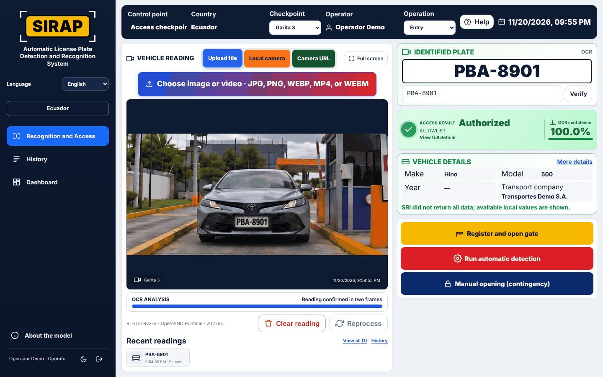
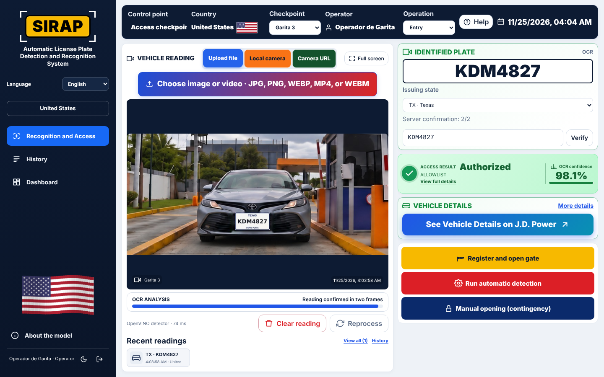
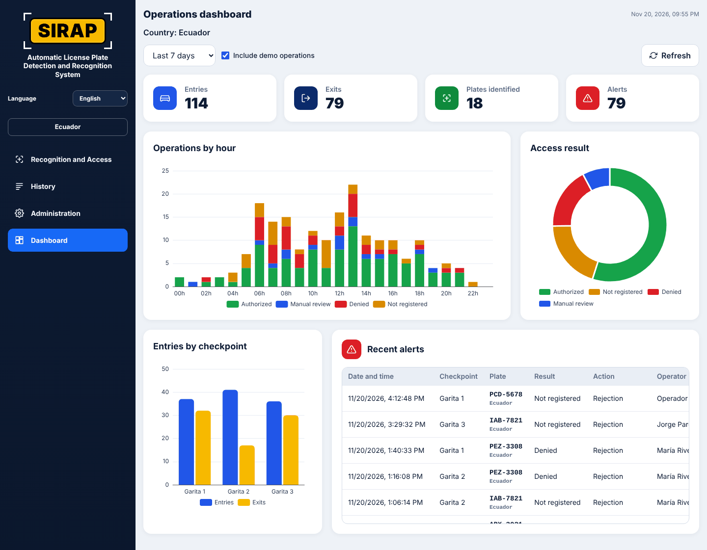
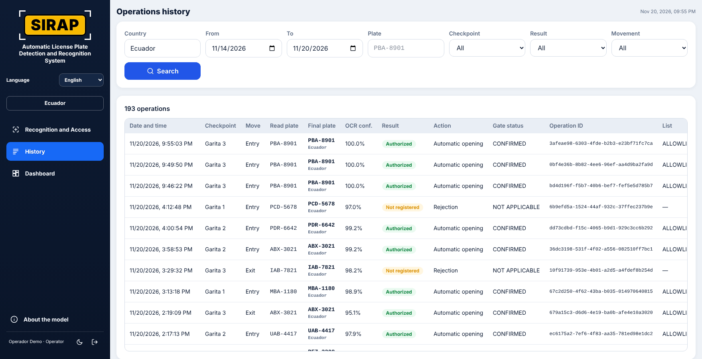
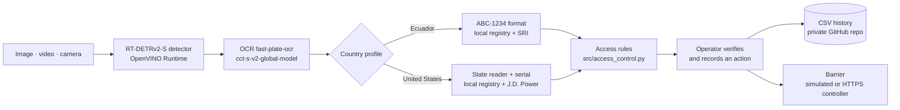
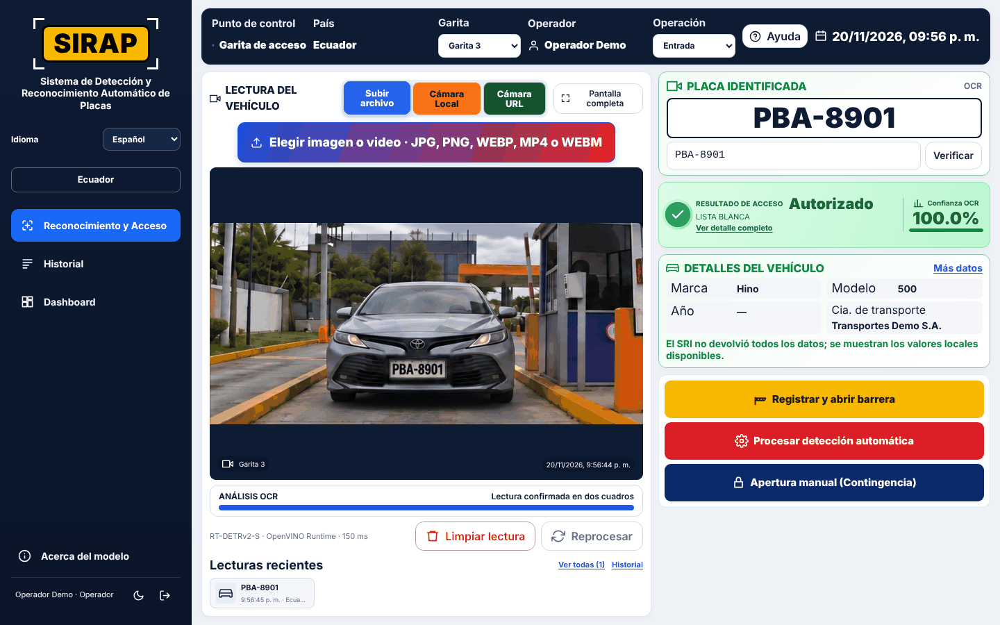
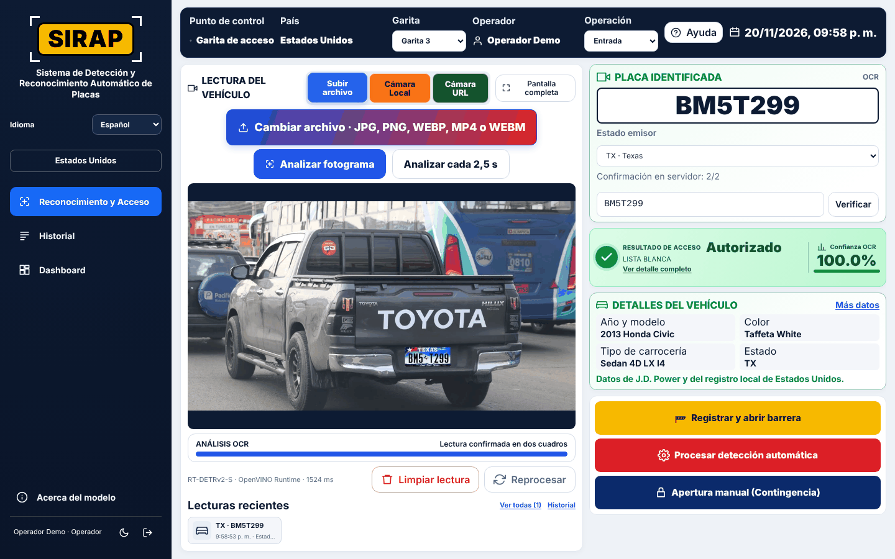
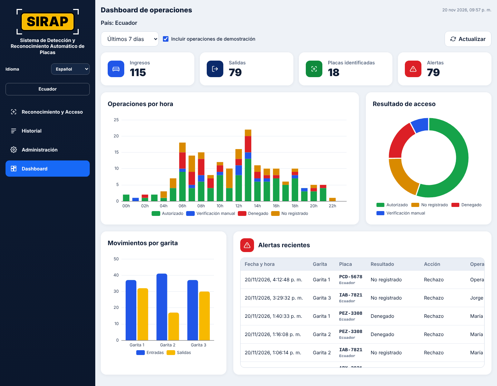
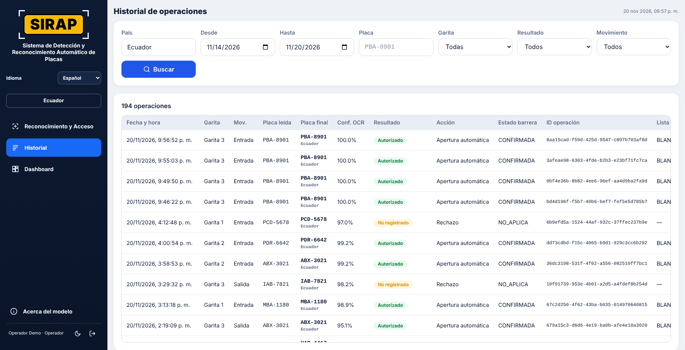
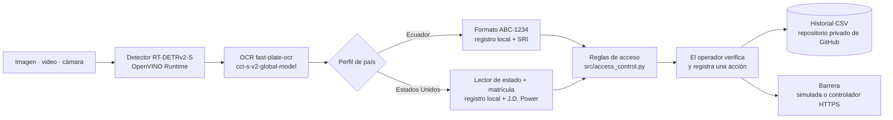

# SIRAP_USA_ECUADOR

[](https://github.com/eduardoceballos666/SIRAP_USA_ECUADOR/actions/workflows/ci.yml)
[](https://huggingface.co/merve/license-plates-rtdetrv2)
[](https://docs.openvino.ai/)
[](frontend/)
[](api/)
[](LICENSE)

**SIRAP** — *Sistema de Detección y Reconocimiento Automático de Placas* — **Automatic License Plate Detection and Recognition System** for vehicle access control, with an **Ecuador** profile and a **United States** profile in the same web application.

🌐 **Language / Idioma:** [English](#english) · [Español](#español)

| | |
|---|---|
| **Live application** | [Hugging Face Space `SIRAP_USA_ECUADOR_HF`](https://huggingface.co/spaces/eduardoceballos/SIRAP_USA_ECUADOR_HF) |
| **User manual (PDF)** | [🇬🇧 English](docs/manual/SIRAP_Manual_EN.pdf) · [🇪🇸 Español](docs/manual/SIRAP_Manual_ES.pdf) |
| **API reference** | `/docs` on the Space URL (OpenAPI) · `/api/health` for a liveness check |
| **Source code, notebooks, tests** | this repository |

---

<a id="english"></a>

# English

## Contents

[What SIRAP is](#what-sirap-is) · [Ecuador and United States at a glance](#ecuador-and-united-states-at-a-glance) · [What the application does](#what-the-application-does) · [How an access decision is made](#how-an-access-decision-is-made) · [Roles and screens](#roles-and-screens) · [Architecture](#architecture) · [Detector and OCR](#detector-and-ocr) · [Configuration](#configuration) · [Run it locally](#run-it-locally) · [Docker, Hugging Face and CI](#docker-hugging-face-and-ci) · [Data, security and privacy](#data-security-and-privacy) · [API overview](#api-overview) · [Training, evaluation and notebooks](#training-evaluation-and-notebooks) · [Results and limitations](#results-and-limitations) · [Documentation](#documentation) · [Authors and license](#authors-and-license)

## What SIRAP is

SIRAP helps a vehicle checkpoint (*garita*) identify license plates in photos, video frames or camera images, compare them with access lists and keep an auditable record of every decision. A **recognized plate is never an authorization**: the application checks the current allowlist and restricted list, shows the result, and the **operator** decides. **The barrier never opens by itself**; the default barrier is simulated.

<p align="center">
  
  
</p>
<p align="center"><em>Left: Ecuador, an authorized plate. Right: United States, the state and serial confirmed in two frames. Screenshots come from a test installation with sample photographs and fictitious demo data.</em></p>

The login screen asks for the **country** and the **interface language**. The country is bound to the session token and to recognition, registry, lists and history, so each profile keeps its own data. Both profiles share the same screens, the same plate detector and the same OCR engine; they differ in how a plate is interpreted and in the rules for opening.

## Ecuador and United States at a glance

| Topic | 🇪🇨 Ecuador | 🇺🇸 United States |
|---|---|---|
| Plate identity | The plate itself: 3 letters + 3 or 4 digits, written `ABC-1234` | **Issuing state + serial**, stored as `US:TX:BM5T299` |
| Issuing state | Not used | Read from the state band of the plate (header or footer, including names glued by the OCR). **Never inferred** from the camera location or the plate design; if it cannot be read, the result is manual review |
| Near matches | A reading one character away from a registered plate → manual review (“Did you mean …?”) | No “did you mean” suggestion: lookups use the exact state + serial |
| Normal opening needs | Current allowlist entry and a confident reading | Current allowlist entry **and two distinct frames confirmed by the server within 7.5 s** (single-use receipt, valid 30 s) |
| Vehicle data | **SRI** (Ecuador's tax service) merged with the local registry | **J.D. Power** plate lookup (year and model, color, body type, state) merged with the local registry |
| Thresholds | Detector ≥ 0.70 · OCR ≥ 0.94 per character | Same |
| Registry, lists, history, dashboard | Separate per country | Separate per country |

Users, checkpoints, screens, roles, detector weights and OCR weights are shared.

## What the application does

**Recognition and Access** (every role)
- Loads a **photo** (JPG, JPEG, PNG, WEBP · ≤ 10 MB · shortest side ≥ 160 px), a **video** (MP4, WEBM, analyzed about once per second until a plate is confirmed in two frames), the **local camera**, or a **camera URL** (web video MP4/WEBM or MJPEG; HLS where the browser supports it).
- Detects the plate, reads its characters, shows the **identified plate** in a large box that can be corrected and re-checked (**Verify**), and reports the **OCR confidence** (the *lowest* per-character probability).
- Produces one of the access results: **Authorized**, **Denied**, **Without authorization**, **Not registered** or **Manual review**, with the reason.
- Shows **vehicle details** (make, model, year, color, body type, transport company) next to the registry data. If the external source does not answer, the panel says so and shows local values; descriptive data never grant access.
- Lets the operator **register a new truck** inline (“Yes, register”) after visually confirming the plate. Registering does not authorize: the allowlist needs the explicit **Authorize now** choice. Existing and restricted plates can never be overwritten from this form.
- Records the action: **Register and open gate** (only when Authorized), **Record rejection**, **Record without opening**, or **Manual opening (contingency)** with a written reason of at least 10 characters.
- Keeps a strip of **recent readings** for the session (exportable to CSV) that is separate from the history.
- **Recovers from failures**: every attempt has a persistent identifier; after a reload, a lost connection or an expired session the screen shows *Operation awaiting confirmation* and **Check result** reads the saved state without resending the opening. An unaccepted attempt can be reserved as cancelled. See [recovery from failures](docs/recuperacion_fallos.md).

**History** — filter by country, dates, plate, checkpoint, result and movement (and by issuing state in the US profile); one row per recorded operation with read plate, final plate, OCR confidence, result, action, reason, barrier state, operation ID, operator and origin. **Supervisor** and **Administrator** can export the filtered rows to CSV.

**Dashboard** — period (today, 7 or 30 days), optional demo data, entries, exits, distinct plates identified, alerts (denied, not registered, manual opening), operations by hour, access results, entries by checkpoint and recent alerts; light and dark themes.

**Administration** (Administrator edits, Supervisor reads) — *Vehicles* (create/update, bulk authorize), *Lists* (allowlist or restricted list with reason and expiry date), *Owners*, *Checkpoints* (add, activate, deactivate), *Users* (create, edit, reset password, activate/deactivate; the last active administrator is protected) and *Demo data* (generate or delete DEMO operations).

**About the model** — detector, thresholds, how it works, limitations and license.

**Everywhere** — six interface languages (English default, Spanish, Portuguese, French, German, Italian), light/dark theme, responsive layout for tablets and phones, and a [bilingual PDF manual](docs/manual/).

<p align="center">
  
  
</p>

## How an access decision is made



**Ecuador**

| Condition | Result |
|---|---|
| Invalid or unreadable plate, detector < 0.70, OCR < 0.94, or one character away from a registered plate | Manual review |
| Exact plate on the restricted list | Denied |
| Plate on the current allowlist | Authorized |
| Registered but without a current permit | Without authorization |
| No record | Not registered |

**United States**

| Condition | Result |
|---|---|
| State or serial not confirmed | Manual review |
| OCR < 0.94 or detector < 0.70 | Manual review |
| Exact state + serial on the restricted list | Denied |
| Current allowlist entry but fewer than 2 confirmed frames | Manual review (waiting for confirmation) |
| Current allowlist entry and 2 distinct confirmed frames within 7.5 s | Authorized |
| Registered without a current permit, or not registered | Without authorization / Not registered |

A current restriction always prevails over an allowlist entry. The server saves the request **before** sending any order to the barrier, checks the authorization again at that moment, and rejects a repeated operation identifier (idempotency), so the same attempt can never open the barrier twice. Manual (contingency) openings require a reason and are stored with the operator's username. The barrier is **simulated** by default; a real controller needs `barrera.modo: "http"` in [`config/config.yaml`](config/config.yaml) plus the secrets `BARRERA_URL` (HTTPS) and `BARRERA_TOKEN`; it receives the operation ID in the JSON body and in an `Idempotency-Key` header and is called once (3 s timeout), without retries or redirects.

### Vehicle data lookups

- **Ecuador** — the SRI public vehicle lookup runs in the background and is merged with the local registry; if the SRI does not answer, the local values are shown. (A paid third-party source was deliberately not used.)
- **United States** — a headless Chromium (Playwright) opens the J.D. Power plate report for state + serial: first the direct URL, then, as a fallback, the page's own lookup form (plate, state, *Check Plate*) in the same browser session. The lookup is polite by design: one request at a time, 2 s between requests, results cached, and **no retries** after HTTP 401/403/429. It is enabled in `config/countries/usa.yaml` (`vehicle_lookup.enabled`); set it to `false` to use local-registry data only.

## Roles and screens

| Role | Menu | Can do |
|---|---|---|
| **Operator** (`OPERADOR`) | Recognition and Access · History · Dashboard | Capture, verify, record actions, register a **new** truck (and authorize it expressly). Cannot change existing records |
| **Supervisor** (`SUPERVISOR`) | Operator menu + Administration (read-only) | Everything above + **CSV export** of the history |
| **Administrator** (`ADMINISTRADOR`) | All screens | Everything above + create/update vehicles, lists, checkpoints and users, and generate/delete demo data |

Routes: `/login`, `/ecuador/…` and `/usa/…` with `reconocimiento`, `historial`, `dashboard`, `administracion` and `modelo`. Authentication uses a signed JWT (HS256, 12 hours by default) that carries the role, country and language.

## Architecture

| Layer | Technology | Location |
|---|---|---|
| Frontend | Vue 3 · Vite · Pinia · Vue Router · Tailwind CSS 4 · ECharts | [`frontend/`](frontend/) |
| API | FastAPI (`auth`, `recognition`, `reports`, `admin` routers) | [`api/`](api/) |
| Recognition | RT-DETRv2-S on OpenVINO Runtime · fast-plate-ocr · Tesseract state reader | [`src/`](src/) (`usa_pipeline.py`, `usa_jurisdiction.py`, `model.py`) |
| Access rules | Pure Python, tested without the model | [`src/access_control.py`](src/access_control.py), [`src/plate_identity.py`](src/plate_identity.py) |
| Vehicle data | SRI (Ecuador), J.D. Power via Playwright (US) | [`src/vehicle_lookup/`](src/vehicle_lookup/), [`api/providers/usa_jdpower.py`](api/providers/usa_jdpower.py) |
| Storage | CSV tables, private GitHub repository as durable source | [`src/storage.py`](src/storage.py), [`src/github_storage.py`](src/github_storage.py) |
| Per-country settings | YAML | [`config/countries/`](config/countries/) |
| Container / deploy | Docker · Hugging Face Space · GitHub Actions | [`Dockerfile`](Dockerfile), [`deploy/huggingface/`](deploy/huggingface/), [`.github/workflows/`](.github/workflows/) |
| Legacy | Earlier Streamlit app (not the deployed interface) | [`app/`](app/), [`app.py`](app.py) |

The container serves the built frontend (`frontend/dist`) and the API from the same FastAPI process on port 7860. More detail: [architecture](docs/arquitectura.md) and [application integration](docs/usa_app_integration.md).

## Detector and OCR

- **Detector:** RT-DETRv2-S (ResNet-18vd) exported to **OpenVINO IR** and run with OpenVINO Runtime on CPU, input 640 × 640, minimum confidence **0.70**. It derives from the plate checkpoint [`merve/license-plates-rtdetrv2`](https://huggingface.co/merve/license-plates-rtdetrv2) (base [`PekingU/rtdetr_v2_r18vd`](https://huggingface.co/PekingU/rtdetr_v2_r18vd)).
- **One checkpoint for both countries:** the **seed-2** detector fine-tuned for the United States. Its weights are in a private Hugging Face model repository and are pinned by commit and SHA-256 in [`models/usa/selected_checkpoint.json`](models/usa/selected_checkpoint.json); the files are verified before the app starts and before each deployment. There are no separate Ecuadorian weights.
- **OCR:** [`fast-plate-ocr`](https://github.com/ankandrew/fast-plate-ocr), model `cct-s-v2-global-model` (ONNX, CPU). A reading is accepted automatically only when the **lowest per-character probability is ≥ 0.94**.
- **State reader (US):** Tesseract over header and footer bands of the plate crop; abstains instead of guessing when the name is stylized or unreadable.

## Configuration

Settings are read from environment variables (see [`api/.env.example`](api/.env.example)) and from [`config/config.yaml`](config/config.yaml) and [`config/countries/*.yaml`](config/countries/). Secrets never go in the repository.

| Variable | Purpose |
|---|---|
| `SIRAP_JWT_SECRET` | Signing key for session tokens (**required**, use a long random value) |
| `SIRAP_JWT_HOURS` | Token lifetime in hours (default 12) |
| `SIRAP_DEMO_PASSWORD` | Initial password of the demo accounts (change it outside a demo) |
| `SIRAP_DATA_DIR` | Directory of the local CSV cache (default `data/processed`) |
| `SIRAP_DATA_GITHUB_REPO` / `SIRAP_DATA_GITHUB_TOKEN` | Private repository that holds the CSV tables, and its token (**secret**) |
| `SIRAP_GITHUB_REQUIRED` | `1` in production (the private repo is the only durable source); `0` for local CSV-only development |
| `SIRAP_CORS_ORIGINS` | Allowed origins for the development frontend |
| `SIRAP_USA_MODEL_TOKEN` | Hugging Face token used to download the private detector/OCR weights |
| `SIRAP_USA_DETECTOR_DIR` / `SIRAP_USA_OCR_DIR` | Use local model folders instead of downloading the pinned ones |
| `SIRAP_FRONTEND_DIST` | Folder with the built frontend (default `frontend/dist`) |
| `BARRERA_URL` / `BARRERA_TOKEN` | Real barrier controller (HTTPS URL and token); used only with `barrera.modo: "http"`, otherwise the barrier is simulated |

## Run it locally

Requirements: Python 3.11, Node 22, Tesseract (with the English data) for the US state reader, and — only for the US J.D. Power lookup — Playwright Chromium (`python -m playwright install chromium`). The pinned detector weights are private: provide `SIRAP_USA_MODEL_TOKEN` (or point `SIRAP_USA_DETECTOR_DIR` / `SIRAP_USA_OCR_DIR` to a local copy that passes the checks).

```bash
# 1) Backend (API on :8000)
python -m pip install -r requirements.txt
cp api/.env.example .env            # edit: JWT secret, SIRAP_GITHUB_REQUIRED=0 for local CSV
export $(grep -v '^#' .env | xargs)
uvicorn api.main:app --reload --port 8000

# 2) Frontend (dev server on :5173, proxies /api to :8000)
cd frontend && npm ci && npm run dev

# 3) Production-style: build the frontend and let FastAPI serve it
cd frontend && npm run build        # creates frontend/dist, served at http://localhost:8000
```

Tests:

```bash
python -m pip install -r requirements-dev.txt
python -m pytest -q                 # backend, rules, storage, recovery, J.D. Power, US runtime
cd frontend && npm test             # frontend unit tests (node --test)
```

## Docker, Hugging Face and CI

- **Docker** ([`Dockerfile`](Dockerfile)): a Node 22 stage builds the frontend; the runtime stage (`python:3.11-slim`) installs Tesseract and Playwright Chromium, copies the app and serves `uvicorn api.main:app` on port **7860**.
- **Hugging Face Space:** every push to `main` that touches app, config, docs or deploy files runs [`deploy-hf-space.yml`](.github/workflows/deploy-hf-space.yml), which executes [`deploy/huggingface/sync_space.py`](deploy/huggingface/sync_space.py): it verifies access and hashes of the pinned weights, uploads the files to the Space and sets the Space secrets. Details in [`deploy/huggingface/README.md`](deploy/huggingface/README.md).
- **CI** ([`ci.yml`](.github/workflows/ci.yml)): frontend job (`npm ci`, `npm test`, `npm run build`) and backend job (hash-checked `pip install`, `python -m pytest -q`).

## Data, security and privacy

- Operational data (users, checkpoints, vehicles, lists, operations) are CSV tables. In production the **private GitHub repository** is the only durable source; the hosting disk is just a cache and a remote outage does not enable an old local copy. CSV updates compare SHA values and abort on conflict. **Do not upload operational data to this repository.**
- Images and videos are processed to read the plate and are not kept as permanent files; the recorded operation (plate, result, action, operator, time) is.
- Roles are enforced in the API, not only in the interface; passwords are stored hashed; the country is part of the token; every opening is stored with the operator's username before the order is sent.
- Demo operations (origin `DEMO`) are marked and can be excluded from the dashboard.
- Use SIRAP for access control, not for indiscriminate surveillance. See the [ethical considerations](docs/consideraciones_eticas.md).

## API overview

Base path `/api`; interactive documentation at `/docs`. Everything except `login` and `health` needs a bearer token.

| Area | Endpoints |
|---|---|
| System | `GET /api/health` · `GET /api/system` |
| Auth | `POST /api/auth/login` · `GET /api/auth/me` |
| Recognition and access | `GET /api/samples` · `POST /api/recognize` · `POST /api/plates/verify` · `POST /api/plates/register` · `POST /api/plates/vehicle-data` and `GET /api/plates/vehicle-data/{id}` · `POST /api/operations` · `GET /api/operations/{uuid}/status` · `POST /api/operations/{uuid}/cancel` |
| History, dashboard, model | `GET /api/operations` · `GET /api/operations/export.csv` (Supervisor/Admin) · `GET /api/dashboard` · `GET /api/model/info` |
| Administration (Admin writes, Supervisor reads) | `/api/admin/{table}` · `/api/admin/vehiculos` · `/api/admin/autorizaciones` (+ `/seleccionadas`) · `/api/admin/garitas` (+ `/estado`) · `/api/admin/usuarios` (+ `/password`, `/estado`) · `/api/admin/demo` |

## Training, evaluation and notebooks

Active training and evaluation live in `src/train.py` and `src/evaluate.py` (COCO Detection and `transformers.Trainer`). Training saves a Safetensors checkpoint and exports an OpenVINO IR; evaluation runs through OpenVINO Runtime.

```bash
python -m pip install -r requirements-dev.txt
python -m src.train --country ecuador --data-dir /path/to/coco-dataset --epochs 30
python -m src.evaluate detector --country ecuador --data-dir /path/to/coco-dataset --split test
```

| Profile | Notebook | Flow |
|---|---|---|
| Ecuador | [`sirap_backend_ecuador.ipynb`](notebooks/ecuador/sirap_backend_ecuador.ipynb) | Unified flow 0–9: COCO, SAVH, training, OCR, OpenVINO, video, camera, latency and optional publishing |
| United States | [`sirap_backend_usa.ipynb`](notebooks/usa/sirap_backend_usa.ipynb) | Frozen seed 2, development check on reviewed photos, isolated access tests, optional research |

`requirements.txt` is the app runtime; `requirements-training.txt` holds the fine-tuning extras. Multi-seed runs and Optuna searches use GPU time and are off by default in the notebooks (see [optimization](docs/optimizacion.md) and the [multi-seed protocol](docs/validacion_savh_multisemilla.md)).

## Results and limitations

- **Ecuador performance has not been evaluated yet.** The shared checkpoint was trained and checked with United States plates; changing OCR rules does not train a model for another country. The *About the model* screen says so.
- **United States state reading** (development measurement, 751 crops with a known state): 523 read (69.6 %), all 523 correct, 0 wrong; stylized or italic state names (e.g. California, Tennessee, South Dakota, Ohio) are not read and the app abstains. Same-state plates share a design, so the held-out half is not independent. This is a **development diagnostic, not an independent test**; see [`models/usa/selected_checkpoint.json`](models/usa/selected_checkpoint.json) (`evaluation_scope`) and [`results/README.md`](results/README.md).
- Software tests use synthetic lists, images and a simulated barrier; they check rules and persistence, not real-world accuracy.
- Light, glare, dirt, motion blur and small or distant plates reduce accuracy; low confidence always goes to manual review.
- The J.D. Power lookup depends on an external page and may stop working if that page changes; the app then falls back to local-registry data.

## Documentation

| Document | Content |
|---|---|
| [**User manual (EN)**](docs/manual/SIRAP_Manual_EN.pdf) · [**Manual de usuario (ES)**](docs/manual/SIRAP_Manual_ES.pdf) | Every screen for both profiles, with screenshots (41 pages each) |
| [`docs/manual/`](docs/manual/) | Source of the manuals and how to rebuild them: `python docs/manual/build_manual.py` (needs `playwright` + Chromium and `pypdf`) |
| [`docs/arquitectura.md`](docs/arquitectura.md) | Architecture |
| [`docs/usa_app_integration.md`](docs/usa_app_integration.md) | US integration, state + serial identity, confirmation |
| [`docs/recuperacion_fallos.md`](docs/recuperacion_fallos.md) | Recovery of operations after cuts and restarts |
| [`docs/consideraciones_eticas.md`](docs/consideraciones_eticas.md) | Ethical considerations |
| [`docs/manual_usuario.md`](docs/manual_usuario.md) | Earlier Spanish manual (superseded by the PDFs) |
| [`THIRD_PARTY_NOTICES.md`](THIRD_PARTY_NOTICES.md) · [`NOTICE`](NOTICE) | Third-party notices and attribution |

## Authors and license

Developed by **Eduardo Alejandro Ceballos Jijón** and **Christian Xavier Valle Marideña** as an integrative project of a Master's program in Artificial Intelligence.

The original code is distributed under the [Apache License 2.0](LICENSE) (see [NOTICE](NOTICE)). The RT-DETRv2 plate checkpoint and OpenVINO declare Apache-2.0; Transformers, PyTorch, the OCR models and datasets keep their own licenses ([third-party notices](THIRD_PARTY_NOTICES.md)).

---

<a id="español"></a>

# Español

## Contenido

[Qué es SIRAP](#qué-es-sirap) · [Ecuador y Estados Unidos de un vistazo](#ecuador-y-estados-unidos-de-un-vistazo) · [Qué hace la aplicación](#qué-hace-la-aplicación) · [Cómo se decide un acceso](#cómo-se-decide-un-acceso) · [Roles y pantallas](#roles-y-pantallas) · [Arquitectura](#arquitectura) · [Detector y OCR](#detector-y-ocr) · [Configuración](#configuración) · [Ejecución local](#ejecución-local) · [Docker, Hugging Face y CI](#docker-hugging-face-y-ci) · [Datos, seguridad y privacidad](#datos-seguridad-y-privacidad) · [Resumen de la API](#resumen-de-la-api) · [Entrenamiento, evaluación y notebooks](#entrenamiento-evaluación-y-notebooks) · [Resultados y limitaciones](#resultados-y-limitaciones) · [Documentación](#documentación) · [Autores y licencia](#autores-y-licencia)

## Qué es SIRAP

SIRAP ayuda a una garita vehicular a identificar placas en fotos, fotogramas de video o imágenes de cámara, compararlas con las listas de acceso y conservar un registro auditable de cada decisión. **Una placa reconocida nunca es una autorización**: la aplicación consulta la lista blanca y la lista restringida vigentes, muestra el resultado y **decide el operador**. **La barrera nunca se abre sola**; por defecto la barrera es simulada.

<p align="center">
  
  
</p>
<p align="center"><em>Izquierda: Ecuador, placa autorizada. Derecha: Estados Unidos, estado y matrícula confirmados en dos cuadros. Las capturas provienen de una instalación de prueba con fotografías de ejemplo y datos de demostración ficticios.</em></p>

Al iniciar sesión se elige el **país** y el **idioma de la interfaz**. El país queda ligado al token de sesión y al reconocimiento, el registro, las listas y el historial, de modo que cada perfil conserva sus propios datos. Ambos perfiles comparten las mismas pantallas, el mismo detector de placas y el mismo motor OCR; difieren en cómo se interpreta la placa y en las reglas de apertura.

## Ecuador y Estados Unidos de un vistazo

| Tema | 🇪🇨 Ecuador | 🇺🇸 Estados Unidos |
|---|---|---|
| Identidad de la placa | La placa misma: 3 letras + 3 o 4 dígitos, escrita `ABC-1234` | **Estado emisor + matrícula**, guardada como `US:TX:BM5T299` |
| Estado emisor | No se usa | Se lee de la franja de estado de la placa (encabezado o pie, incluidos nombres pegados por el OCR). **Nunca se infiere** por la ubicación de la cámara ni por el diseño de la placa; si no puede leerse, el resultado es verificación manual |
| Coincidencias cercanas | Una lectura a un carácter de una placa registrada → verificación manual («¿Quiso decir …?») | Sin sugerencia «¿quiso decir?»: la consulta usa el estado + matrícula exactos |
| La apertura normal requiere | Entrada vigente en la lista blanca y una lectura segura | Entrada vigente en la lista blanca **y dos cuadros distintos confirmados por el servidor en 7,5 s** (comprobante de un solo uso, válido 30 s) |
| Datos del vehículo | **SRI** (Servicio de Rentas Internas) combinado con el registro local | Consulta de placa en **J.D. Power** (año y modelo, color, carrocería, estado) combinada con el registro local |
| Umbrales | Detector ≥ 0,70 · OCR ≥ 0,94 por carácter | Igual |
| Registro, listas, historial, dashboard | Independientes por país | Independientes por país |

Usuarios, garitas, pantallas, roles, pesos del detector y pesos del OCR son comunes.

## Qué hace la aplicación

**Reconocimiento y Acceso** (todos los roles)
- Carga una **foto** (JPG, JPEG, PNG, WEBP · ≤ 10 MB · lado menor ≥ 160 px), un **video** (MP4, WEBM; se analiza cerca de una vez por segundo hasta confirmar la placa en dos cuadros), la **cámara local** o una **cámara por URL** (video web MP4/WEBM o MJPEG; HLS donde el navegador lo admite).
- Detecta la placa, lee sus caracteres, muestra la **placa identificada** en un cuadro grande que puede corregirse y volver a consultarse (**Verificar**) e informa la **confianza OCR** (la probabilidad *mínima* por carácter).
- Produce uno de los resultados de acceso: **Autorizado**, **Denegado**, **Sin autorización**, **No registrado** o **Verificación manual**, con el motivo.
- Muestra los **detalles del vehículo** (marca, modelo, año, color, carrocería, compañía de transporte) junto a los datos del registro. Si la fuente externa no responde, el panel lo indica y muestra los valores locales; los datos descriptivos nunca otorgan acceso.
- Permite **registrar un camión nuevo** en línea («Sí, registrar») tras confirmar visualmente la placa. Registrar no autoriza: la lista blanca exige la opción explícita **Autorizar ahora**. Una placa existente o restringida nunca puede sobrescribirse desde este formulario.
- Registra la acción: **Registrar y abrir barrera** (solo si está Autorizado), **Registrar rechazo**, **Registrar sin abrir** o **Apertura manual (contingencia)** con un motivo escrito de al menos 10 caracteres.
- Mantiene una franja de **lecturas recientes** de la sesión (exportable a CSV) separada del historial.
- **Se recupera de fallos**: cada intento tiene un identificador persistente; tras recargar la página, perder la conexión o caducar la sesión, la pantalla muestra *Operación pendiente de confirmar* y **Consultar resultado** lee el estado guardado sin reenviar la apertura. Un intento no aceptado puede reservarse como cancelado. Véase la [recuperación ante fallos](docs/recuperacion_fallos.md).

**Historial** — filtros por país, fechas, placa, garita, resultado y movimiento (y por estado emisor en el perfil de Estados Unidos); una fila por operación registrada con placa leída, placa final, confianza OCR, resultado, acción, motivo, estado de la barrera, ID de operación, operador y origen. **Supervisor** y **Administrador** pueden exportar las filas filtradas a CSV.

**Dashboard** — periodo (hoy, 7 o 30 días), datos de demostración opcionales, ingresos, salidas, placas distintas identificadas, alertas (denegadas, no registradas, aperturas manuales), operaciones por hora, resultados de acceso, ingresos por garita y alertas recientes; temas claro y oscuro.

**Administración** (el Administrador edita, el Supervisor consulta) — *Vehículos* (crear/actualizar, autorización masiva), *Listas* (lista blanca o restringida con motivo y vigencia), *Propietarios*, *Garitas* (agregar, activar, inactivar), *Usuarios* (crear, editar, restablecer contraseña, activar/inactivar; se protege al último administrador activo) y *Datos demo* (generar o borrar operaciones DEMO).

**Acerca del modelo** — detector, umbrales, cómo funciona, limitaciones y licencia.

**En todas partes** — seis idiomas de interfaz (inglés por defecto, español, portugués, francés, alemán, italiano), tema claro/oscuro, diseño adaptable a tabletas y teléfonos y un [manual PDF bilingüe](docs/manual/).

<p align="center">
  
  
</p>

## Cómo se decide un acceso



**Ecuador**

| Condición | Resultado |
|---|---|
| Placa inválida o ilegible, detector < 0,70, OCR < 0,94, o a un carácter de una placa registrada | Verificación manual |
| Placa exacta en la lista restringida | Denegado |
| Placa en la lista blanca vigente | Autorizado |
| Registrada pero sin permiso vigente | Sin autorización |
| Sin registro | No registrado |

**Estados Unidos**

| Condición | Resultado |
|---|---|
| Estado o matrícula sin confirmar | Verificación manual |
| OCR < 0,94 o detector < 0,70 | Verificación manual |
| Estado + matrícula exactos en la lista restringida | Denegado |
| Entrada vigente en la lista blanca pero con menos de 2 cuadros confirmados | Verificación manual (confirmación pendiente) |
| Entrada vigente en la lista blanca y 2 cuadros distintos confirmados en 7,5 s | Autorizado |
| Registrada sin permiso vigente, o no registrada | Sin autorización / No registrado |

Una restricción vigente prevalece siempre sobre una entrada de la lista blanca. El servidor guarda la solicitud **antes** de enviar cualquier orden a la barrera, vuelve a comprobar la autorización en ese momento y rechaza un identificador de operación repetido (idempotencia), de modo que un mismo intento nunca puede abrir la barrera dos veces. Las aperturas manuales (contingencia) exigen un motivo y se guardan con el usuario del operador. La barrera es **simulada** por defecto; un controlador real necesita `barrera.modo: "http"` en [`config/config.yaml`](config/config.yaml) y los secretos `BARRERA_URL` (HTTPS) y `BARRERA_TOKEN`; recibe el ID de operación en el cuerpo JSON y en la cabecera `Idempotency-Key` y se invoca una sola vez (tiempo límite de 3 s), sin reintentos ni redirecciones.

### Consultas de datos del vehículo

- **Ecuador** — la consulta pública de vehículos del SRI se ejecuta en segundo plano y se combina con el registro local; si el SRI no responde, se muestran los valores locales. (Se descartó deliberadamente una fuente de pago de terceros.)
- **Estados Unidos** — un Chromium sin interfaz (Playwright) abre el informe de placa de J.D. Power para estado + matrícula: primero la URL directa y, como respaldo, el formulario de consulta de la propia página (placa, estado, *Check Plate*) en la misma sesión del navegador. La consulta es cortés por diseño: una solicitud a la vez, 2 s entre solicitudes, resultados en caché y **sin reintentos** tras HTTP 401/403/429. Se activa en `config/countries/usa.yaml` (`vehicle_lookup.enabled`); con `false` solo se usan datos del registro local.

## Roles y pantallas

| Rol | Menú | Puede |
|---|---|---|
| **Operador** (`OPERADOR`) | Reconocimiento y Acceso · Historial · Dashboard | Capturar, verificar, registrar acciones, registrar un camión **nuevo** (y autorizarlo de forma expresa). No puede modificar registros existentes |
| **Supervisor** (`SUPERVISOR`) | Menú del operador + Administración (solo lectura) | Todo lo anterior + **exportación CSV** del historial |
| **Administrador** (`ADMINISTRADOR`) | Todas las pantallas | Todo lo anterior + crear/actualizar vehículos, listas, garitas y usuarios, y generar/borrar datos de demostración |

Rutas: `/login`, `/ecuador/…` y `/usa/…` con `reconocimiento`, `historial`, `dashboard`, `administracion` y `modelo`. La autenticación usa un JWT firmado (HS256, 12 horas por defecto) que lleva el rol, el país y el idioma.

## Arquitectura

| Capa | Tecnología | Ubicación |
|---|---|---|
| Frontend | Vue 3 · Vite · Pinia · Vue Router · Tailwind CSS 4 · ECharts | [`frontend/`](frontend/) |
| API | FastAPI (routers `auth`, `recognition`, `reports`, `admin`) | [`api/`](api/) |
| Reconocimiento | RT-DETRv2-S con OpenVINO Runtime · fast-plate-ocr · lector de estado con Tesseract | [`src/`](src/) (`usa_pipeline.py`, `usa_jurisdiction.py`, `model.py`) |
| Reglas de acceso | Python puro, probado sin el modelo | [`src/access_control.py`](src/access_control.py), [`src/plate_identity.py`](src/plate_identity.py) |
| Datos del vehículo | SRI (Ecuador), J.D. Power con Playwright (EE. UU.) | [`src/vehicle_lookup/`](src/vehicle_lookup/), [`api/providers/usa_jdpower.py`](api/providers/usa_jdpower.py) |
| Almacenamiento | Tablas CSV, repositorio privado de GitHub como fuente duradera | [`src/storage.py`](src/storage.py), [`src/github_storage.py`](src/github_storage.py) |
| Parámetros por país | YAML | [`config/countries/`](config/countries/) |
| Contenedor / despliegue | Docker · Hugging Face Space · GitHub Actions | [`Dockerfile`](Dockerfile), [`deploy/huggingface/`](deploy/huggingface/), [`.github/workflows/`](.github/workflows/) |
| Heredado | Aplicación Streamlit anterior (no es la interfaz desplegada) | [`app/`](app/), [`app.py`](app.py) |

El contenedor sirve el frontend compilado (`frontend/dist`) y la API desde el mismo proceso FastAPI en el puerto 7860. Más detalle: [arquitectura](docs/arquitectura.md) e [integración de la aplicación](docs/usa_app_integration.md).

## Detector y OCR

- **Detector:** RT-DETRv2-S (ResNet-18vd) exportado a **OpenVINO IR** y ejecutado con OpenVINO Runtime en CPU, entrada 640 × 640, confianza mínima **0,70**. Deriva del checkpoint de placas [`merve/license-plates-rtdetrv2`](https://huggingface.co/merve/license-plates-rtdetrv2) (base [`PekingU/rtdetr_v2_r18vd`](https://huggingface.co/PekingU/rtdetr_v2_r18vd)).
- **Un solo checkpoint para ambos países:** el detector de **semilla 2** ajustado para Estados Unidos. Sus pesos están en un repositorio privado de modelos de Hugging Face y se fijan por commit y SHA-256 en [`models/usa/selected_checkpoint.json`](models/usa/selected_checkpoint.json); los archivos se verifican antes de iniciar la app y antes de cada despliegue. No existen pesos ecuatorianos separados.
- **OCR:** [`fast-plate-ocr`](https://github.com/ankandrew/fast-plate-ocr), modelo `cct-s-v2-global-model` (ONNX, CPU). Una lectura se acepta automáticamente solo cuando la **probabilidad mínima por carácter es ≥ 0,94**.
- **Lector de estado (EE. UU.):** Tesseract sobre franjas de encabezado y pie del recorte de la placa; se abstiene en lugar de adivinar cuando el nombre es estilizado o ilegible.

## Configuración

Los parámetros se leen de variables de entorno (véase [`api/.env.example`](api/.env.example)) y de [`config/config.yaml`](config/config.yaml) y [`config/countries/*.yaml`](config/countries/). Los secretos nunca van en el repositorio.

| Variable | Propósito |
|---|---|
| `SIRAP_JWT_SECRET` | Clave de firma de los tokens de sesión (**obligatoria**, use un valor largo y aleatorio) |
| `SIRAP_JWT_HOURS` | Duración del token en horas (12 por defecto) |
| `SIRAP_DEMO_PASSWORD` | Contraseña inicial de las cuentas de demostración (cámbiela fuera de una demo) |
| `SIRAP_DATA_DIR` | Directorio de la caché local de CSV (`data/processed` por defecto) |
| `SIRAP_DATA_GITHUB_REPO` / `SIRAP_DATA_GITHUB_TOKEN` | Repositorio privado con las tablas CSV y su token (**secreto**) |
| `SIRAP_GITHUB_REQUIRED` | `1` en producción (el repositorio privado es la única fuente duradera); `0` para desarrollo local solo con CSV |
| `SIRAP_CORS_ORIGINS` | Orígenes permitidos para el frontend de desarrollo |
| `SIRAP_USA_MODEL_TOKEN` | Token de Hugging Face para descargar los pesos privados del detector y del OCR |
| `SIRAP_USA_DETECTOR_DIR` / `SIRAP_USA_OCR_DIR` | Usar carpetas locales de modelos en lugar de descargar las fijadas |
| `SIRAP_FRONTEND_DIST` | Carpeta del frontend compilado (`frontend/dist` por defecto) |
| `BARRERA_URL` / `BARRERA_TOKEN` | Controlador real de la barrera (URL HTTPS y token); solo con `barrera.modo: "http"`, de lo contrario la barrera es simulada |

## Ejecución local

Requisitos: Python 3.11, Node 22, Tesseract (con los datos en inglés) para el lector de estado de EE. UU. y, solo para la consulta de J.D. Power, Chromium de Playwright (`python -m playwright install chromium`). Los pesos fijados del detector son privados: defina `SIRAP_USA_MODEL_TOKEN` (o apunte `SIRAP_USA_DETECTOR_DIR` / `SIRAP_USA_OCR_DIR` a una copia local que supere las verificaciones).

```bash
# 1) Backend (API en :8000)
python -m pip install -r requirements.txt
cp api/.env.example .env            # edite: secreto JWT, SIRAP_GITHUB_REQUIRED=0 para CSV local
export $(grep -v '^#' .env | xargs)
uvicorn api.main:app --reload --port 8000

# 2) Frontend (servidor de desarrollo en :5173, redirige /api a :8000)
cd frontend && npm ci && npm run dev

# 3) Estilo producción: compile el frontend y deje que FastAPI lo sirva
cd frontend && npm run build        # crea frontend/dist, servido en http://localhost:8000
```

Pruebas:

```bash
python -m pip install -r requirements-dev.txt
python -m pytest -q                 # backend, reglas, almacenamiento, recuperación, J.D. Power, runtime de EE. UU.
cd frontend && npm test             # pruebas unitarias del frontend (node --test)
```

## Docker, Hugging Face y CI

- **Docker** ([`Dockerfile`](Dockerfile)): una etapa con Node 22 compila el frontend; la etapa de ejecución (`python:3.11-slim`) instala Tesseract y Chromium de Playwright, copia la aplicación y sirve `uvicorn api.main:app` en el puerto **7860**.
- **Hugging Face Space:** cada push a `main` que toque archivos de la app, configuración, documentación o despliegue ejecuta [`deploy-hf-space.yml`](.github/workflows/deploy-hf-space.yml), que lanza [`deploy/huggingface/sync_space.py`](deploy/huggingface/sync_space.py): verifica el acceso y los hashes de los pesos fijados, sube los archivos al Space y configura sus secretos. Detalles en [`deploy/huggingface/README.md`](deploy/huggingface/README.md).
- **CI** ([`ci.yml`](.github/workflows/ci.yml)): trabajo de frontend (`npm ci`, `npm test`, `npm run build`) y de backend (`pip install` con verificación de hashes, `python -m pytest -q`).

## Datos, seguridad y privacidad

- Los datos operativos (usuarios, garitas, vehículos, listas, operaciones) son tablas CSV. En producción el **repositorio privado de GitHub** es la única fuente duradera; el disco del hosting es solo una caché y una caída remota no habilita una copia local antigua. Las actualizaciones de CSV comparan el SHA y se abortan ante un conflicto. **No suba datos operativos a este repositorio.**
- Las imágenes y los videos se procesan para leer la placa y no se conservan como archivos permanentes; sí se conserva la operación registrada (placa, resultado, acción, operador, hora).
- Los roles se aplican en la API, no solo en la interfaz; las contraseñas se guardan con hash; el país forma parte del token; cada apertura se guarda con el usuario del operador antes de enviar la orden.
- Las operaciones de demostración (origen `DEMO`) están marcadas y pueden excluirse del dashboard.
- Use SIRAP para el control de acceso, no para la vigilancia indiscriminada. Véanse las [consideraciones éticas](docs/consideraciones_eticas.md).

## Resumen de la API

Ruta base `/api`; documentación interactiva en `/docs`. Todo, salvo `login` y `health`, requiere un token *bearer*.

| Área | Endpoints |
|---|---|
| Sistema | `GET /api/health` · `GET /api/system` |
| Autenticación | `POST /api/auth/login` · `GET /api/auth/me` |
| Reconocimiento y acceso | `GET /api/samples` · `POST /api/recognize` · `POST /api/plates/verify` · `POST /api/plates/register` · `POST /api/plates/vehicle-data` y `GET /api/plates/vehicle-data/{id}` · `POST /api/operations` · `GET /api/operations/{uuid}/status` · `POST /api/operations/{uuid}/cancel` |
| Historial, dashboard, modelo | `GET /api/operations` · `GET /api/operations/export.csv` (Supervisor/Admin) · `GET /api/dashboard` · `GET /api/model/info` |
| Administración (el Admin escribe, el Supervisor consulta) | `/api/admin/{table}` · `/api/admin/vehiculos` · `/api/admin/autorizaciones` (+ `/seleccionadas`) · `/api/admin/garitas` (+ `/estado`) · `/api/admin/usuarios` (+ `/password`, `/estado`) · `/api/admin/demo` |

## Entrenamiento, evaluación y notebooks

El entrenamiento y la evaluación activos están en `src/train.py` y `src/evaluate.py` (COCO Detection y `transformers.Trainer`). El entrenamiento guarda un checkpoint Safetensors y exporta un IR de OpenVINO; la evaluación se ejecuta con OpenVINO Runtime.

```bash
python -m pip install -r requirements-dev.txt
python -m src.train --country ecuador --data-dir /ruta/dataset-coco --epochs 30
python -m src.evaluate detector --country ecuador --data-dir /ruta/dataset-coco --split test
```

| Perfil | Notebook | Flujo |
|---|---|---|
| Ecuador | [`sirap_backend_ecuador.ipynb`](notebooks/ecuador/sirap_backend_ecuador.ipynb) | Flujo unificado 0–9: COCO, SAVH, entrenamiento, OCR, OpenVINO, video, cámara, latencia y publicación opcional |
| Estados Unidos | [`sirap_backend_usa.ipynb`](notebooks/usa/sirap_backend_usa.ipynb) | Semilla 2 congelada, comprobación de desarrollo con fotos revisadas, pruebas aisladas de acceso, investigación opcional |

`requirements.txt` es el runtime de la app; `requirements-training.txt` reúne los extras de ajuste fino. Las corridas multisemilla y las búsquedas Optuna consumen GPU y están apagadas por defecto en los notebooks (véanse [optimización](docs/optimizacion.md) y el [protocolo multisemilla](docs/validacion_savh_multisemilla.md)).

## Resultados y limitaciones

- **El rendimiento en Ecuador aún no se ha evaluado.** El checkpoint compartido se entrenó y verificó con placas de Estados Unidos; cambiar las reglas del OCR no entrena un modelo para otro país. La pantalla *Acerca del modelo* lo indica.
- **Lectura del estado en EE. UU.** (medición de desarrollo, 751 recortes con estado conocido): 523 leídos (69,6 %), los 523 correctos, 0 erróneos; los nombres de estado estilizados o en cursiva (p. ej. California, Tennessee, South Dakota, Ohio) no se leen y la app se abstiene. Las placas de un mismo estado comparten diseño, por lo que la mitad reservada no es independiente. Es un **diagnóstico de desarrollo, no una prueba independiente**; véanse [`models/usa/selected_checkpoint.json`](models/usa/selected_checkpoint.json) (`evaluation_scope`) y [`results/README.md`](results/README.md).
- Los archivos antiguos con `yolo11` en el nombre y los informes SAVH describen experimentos anteriores; no validan el checkpoint actual ni su adopción en Ecuador.
- Las pruebas de software usan listas, imágenes y una barrera sintéticas; comprueban reglas y persistencia, no la precisión en condiciones reales.
- La poca luz, los reflejos, la suciedad, el desenfoque por movimiento y las placas pequeñas o lejanas reducen la precisión; la confianza baja siempre pasa a verificación manual.
- La consulta de J.D. Power depende de una página externa y puede dejar de funcionar si esa página cambia; la app recurre entonces a los datos del registro local.

## Documentación

| Documento | Contenido |
|---|---|
| [**Manual de usuario (ES)**](docs/manual/SIRAP_Manual_ES.pdf) · [**User manual (EN)**](docs/manual/SIRAP_Manual_EN.pdf) | Todas las pantallas de ambos perfiles, con capturas (41 páginas cada uno) |
| [`docs/manual/`](docs/manual/) | Fuente de los manuales y cómo regenerarlos: `python docs/manual/build_manual.py` (requiere `playwright` + Chromium y `pypdf`) |
| [`docs/arquitectura.md`](docs/arquitectura.md) | Arquitectura |
| [`docs/usa_app_integration.md`](docs/usa_app_integration.md) | Integración de EE. UU., identidad estado + matrícula, confirmación |
| [`docs/recuperacion_fallos.md`](docs/recuperacion_fallos.md) | Recuperación de operaciones tras cortes y reinicios |
| [`docs/consideraciones_eticas.md`](docs/consideraciones_eticas.md) | Consideraciones éticas |
| [`docs/manual_usuario.md`](docs/manual_usuario.md) | Manual anterior en español (sustituido por los PDF) |
| [`THIRD_PARTY_NOTICES.md`](THIRD_PARTY_NOTICES.md) · [`NOTICE`](NOTICE) | Avisos de terceros y atribución |

## Autores y licencia

Desarrollado por **Eduardo Alejandro Ceballos Jijón** y **Christian Xavier Valle Marideña** como proyecto integrador de una maestría en Inteligencia Artificial.

El código original se distribuye bajo la [Apache License 2.0](LICENSE) (véase [NOTICE](NOTICE)). El checkpoint RT-DETRv2 de placas y OpenVINO declaran Apache-2.0; Transformers, PyTorch, los modelos OCR y los conjuntos de datos conservan sus licencias ([avisos de terceros](THIRD_PARTY_NOTICES.md)).
