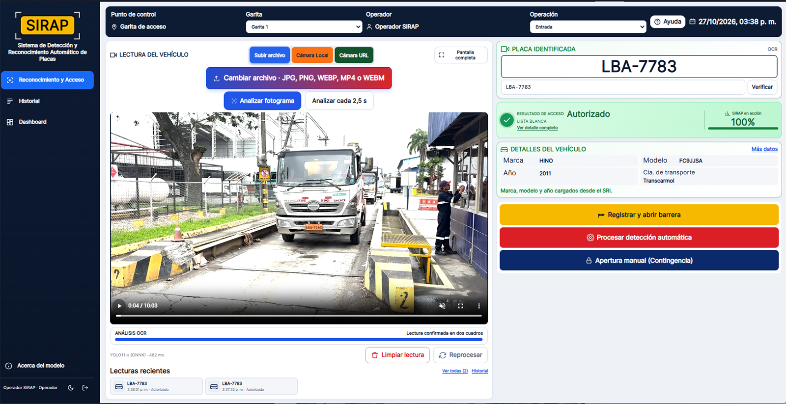
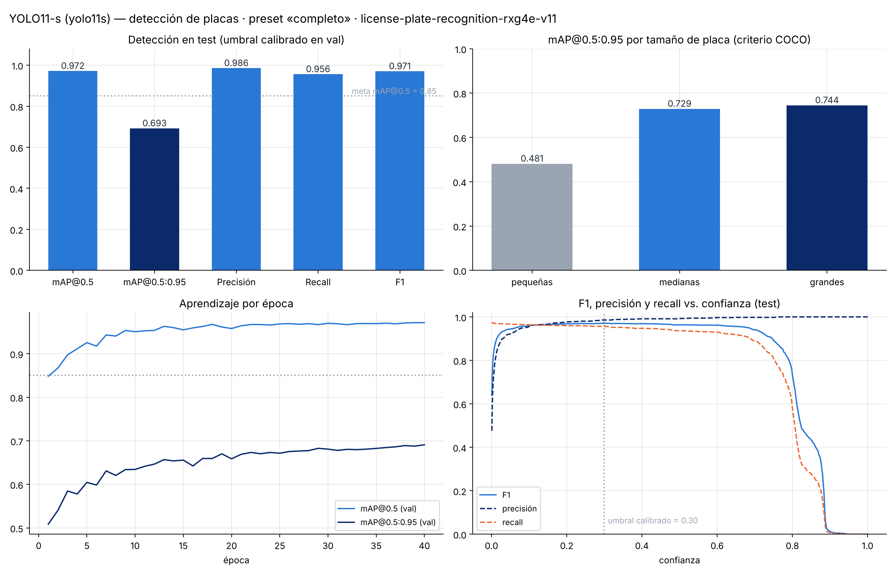

# SIRAP
### Sistema de Detección y Reconocimiento Automático de Placas
### Automatic License Plate Detection and Recognition System

[Español](#español) · [English](#english)

**Aplicación web para apoyar el control de acceso vehicular en garitas.**  
**A web application that supports vehicle access checks at checkpoints.**

[Aplicación en vivo](https://huggingface.co/spaces/eduardoceballos/SIRAP_USA_ECUADOR_HF) · [Manual de usuario](docs/manual_usuario.md) · Swagger en la ruta `/docs` del Space · [Notebook principal](notebooks/ecuador/sirap_backend.ipynb)


**Interfaz disponible en inglés, español, portugués brasileño, francés y alemán. El inglés es el idioma inicial.**  
**The interface is available in English, Spanish, Brazilian Portuguese, French, and German. English is the default language.**



## Español

### Contenido

1. [Estado del proyecto](#estado-del-proyecto)
2. [Plataformas de acceso](#plataformas-de-acceso)
3. [Alcance por país](#alcance-por-país)
4. [Qué hace SIRAP](#qué-hace-sirap)
5. [Interfaz y módulos](#interfaz-y-módulos)
6. [Roles](#roles)
7. [API REST](#api-rest)
8. [Arquitectura y tecnología](#arquitectura-y-tecnología)
9. [Datos y recursos](#datos-y-recursos)
10. [Modelo y resultados](#modelo-y-resultados)
11. [Instalación local](#instalación-local)
12. [Notebook y reproducibilidad](#notebook-y-reproducibilidad)
13. [Privacidad, seguridad y uso responsable](#privacidad-seguridad-y-uso-responsable)
14. [Estructura del repositorio](#estructura-del-repositorio)
15. [Documentación del proyecto](#documentación-del-proyecto)
16. [Autores](#autores)
17. [Licencia y atribuciones](#licencia-y-atribuciones)
18. [Agradecimientos y recursos](#agradecimientos-y-recursos)
19. [Videos de entrega](#videos-de-entrega)


### Estado del proyecto

| Dato | Estado |
|---|---|
| Versión del producto | SIRAP 1.0 |
| Fecha de terminación de la aplicación | **30 de octubre de 2026** |
| API | FastAPI; identificador técnico 2.0.0 |
| Interfaz web | Vue 3; el paquete npm usa el identificador técnico 2.0.0 |
| Despliegue | Hugging Face Spaces con Docker |
| Barrera | Simulada; la aplicación no acciona una barrera física |

El tag de GitHub v2.0 identifica una versión técnica del repositorio con arquitectura FastAPI y Vue 3. No representa la versión del producto, que es SIRAP 1.0.

### Plataformas de acceso

SIRAP USA Ecuador se publica en dos lugares con propósitos distintos:

| Plataforma | Contenido |
|---|---|
| [GitHub: SIRAP_USA_ECUADOR](https://github.com/eduardoceballos666/SIRAP_USA_ECUADOR) | Código fuente, notebooks, modelos, datos de evaluación, métricas, documentación y configuración de despliegue |
| [Hugging Face Space: SIRAP_USA_ECUADOR_HF](https://huggingface.co/spaces/eduardoceballos/SIRAP_USA_ECUADOR_HF) | Aplicación web desplegada |
| [Abrir la aplicación](https://huggingface.co/spaces/eduardoceballos/SIRAP_USA_ECUADOR_HF) | Acceso al Space de Hugging Face |
| Swagger | La API interactiva estará disponible en la ruta `/docs` de la aplicación desplegada |

#### Uso de la aplicación desplegada

1. Abre el [Space SIRAP_USA_ECUADOR_HF](https://huggingface.co/spaces/eduardoceballos/SIRAP_USA_ECUADOR_HF).
2. En el inicio de sesión, elige English, Español, Português (Brasil), Français o Deutsch. El selector también está en el menú y conserva la preferencia en el navegador.
3. Inicia sesión con una cuenta habilitada. La contraseña se configura mediante `SIRAP_DEMO_PASSWORD`; si el secreto no está definido, la API usa el valor predeterminado configurado en `api/settings.py`. Para el Space público, configura explícitamente un valor propio.
4. En Reconocimiento y Acceso, usa un ejemplo, una imagen, un video o una cámara disponible. Revisa la placa, la confianza, el recorte y la decisión.
5. Confirma la información antes de registrar una operación o solicitar la apertura. Las lecturas inciertas requieren revisión humana; la barrera del Space es simulada.
6. Consulta las operaciones en Historial. Supervisor y Administrador pueden exportar los resultados filtrados a CSV.

El Space se construye con Docker y sirve la API y la interfaz Vue. El almacenamiento local de Hugging Face es temporal; los registros operativos persistentes se guardan en el repositorio privado configurado para la aplicación. El despliegue de esta variante se inicia manualmente desde el workflow [deploy-hf-space.yml](.github/workflows/deploy-hf-space.yml). Revisa [la configuración de GitHub Actions](docs/CONFIGURACION_GITHUB_ACTIONS.md).

### Alcance por país

El flujo operativo actual está enfocado en Ecuador y consulta los datos vehiculares ecuatorianos mediante el SRI. El repositorio separa los datos, configuraciones, modelos y evaluaciones por país: los datos ecuatorianos están en `datasets/ecuador/` y los de EE. UU. en `datasets/usa/`. Los materiales estadounidenses están en preparación; la lectura del estado y la consulta a J.D. Power aún no están habilitadas. Esa integración requiere una API autorizada o permiso escrito para automatización.

### Qué hace SIRAP

SIRAP ayuda al operador a revisar el ingreso de un vehículo mediante el flujo:

**Captura de imagen o video → detección de placa → lectura OCR → consulta de autorización → decisión → registro de la operación.**

El sistema consulta listas de autorización y restricción, muestra la confianza y los datos disponibles, y pide revisión humana cuando la lectura es dudosa. El servidor vuelve a comprobar la autorización al registrar una operación. La aplicación propone y registra una solicitud de apertura; en la demostración, la barrera es simulada.

#### Interfaz y módulos

La aplicación ofrece inglés, español, portugués brasileño, francés y alemán desde el selector de idioma de la pantalla de inicio de sesión y del menú. El inglés es el idioma inicial; la preferencia seleccionada se conserva en el navegador.

| Módulo | Funciones |
|---|---|
| Inicio de sesión | Acceso autenticado y operaciones vinculadas al usuario y su rol |
| Reconocimiento y Acceso | Probar un ejemplo, cargar una imagen o usar la cámara; ver placa, recorte, caja, confianza OCR y decisión; corregir o verificar una lectura; registrar el resultado y solicitar apertura; apertura manual con motivo; lecturas de la sesión y exportación |
| Dashboard | Indicadores de entradas, salidas, placas y alertas, con gráficos por hora, resultado y garita |
| Historial | Consulta filtrada de operaciones y exportación CSV para Supervisor y Administrador |
| Administración | Gestión de vehículos, autorizaciones, restricciones, garitas, usuarios y datos de demostración |
| Acerca del modelo | Explicación del modelo, resultados, entrenamiento y limitaciones |

Capturas: [Reconocimiento](docs/images/vue_reconocimiento.png), [Dashboard](docs/images/vue_dashboard.png), [Verificación](docs/images/vue_verificacion.png) y [vista móvil](docs/images/vue_movil.png).

La interfaz es adaptable a celular y escritorio. El tema claro es el predeterminado en ambos; el usuario también puede seleccionar el tema oscuro. Valida el tipo, el tamaño y la resolución de las imágenes, muestra estados de carga y mensajes de error comprensibles, y permite comparar las lecturas obtenidas durante la sesión.

#### Roles

- **Operador:** reconoce placas, verifica o corrige lecturas y registra operaciones. Los perfiles autenticados pueden proponer el registro de una placa nueva; autorizarla requiere una confirmación explícita.
- **Supervisor:** consulta el historial y exporta sus resultados.
- **Administrador:** gestiona los registros y la configuración desde Administración.

Los cambios a registros existentes y la administración de listas están restringidos al Administrador. La lectura de tablas administrativas mediante la API y la pantalla de Administración están disponibles para Supervisor y Administrador.

#### API REST

La API publica documentación interactiva en [Swagger](https://huggingface.co/spaces/eduardoceballos/SIRAP_USA_ECUADOR_HF). Los principales endpoints son:

| Endpoint | Acceso | Función |
|---|---|---|
| POST /api/auth/login · GET /api/auth/me | Público / autenticado | Inicio de sesión JWT y consulta de identidad |
| POST /api/recognize | Todos los perfiles autenticados | Analizar imagen y devolver placa, confianza, recorte y decisión sin registrar |
| POST /api/plates/verify | Todos los perfiles autenticados | Verificar una placa escrita o corregida |
| POST /api/plates/register | Todos los perfiles autenticados | Proponer el registro de un vehículo nuevo; autorización explícita |
| POST /api/operations | Todos los perfiles autenticados | Revalidar la decisión, registrar la solicitud y el estado de barrera |
| GET /api/operations · /api/operations/export.csv | Historial / Supervisor y Administrador | Consultar y exportar operaciones |
| GET /api/dashboard | Todos los perfiles autenticados | Indicadores y datos de los gráficos |
| GET /api/admin/{table} | Supervisor y Administrador | Consultar tablas administrativas |
| POST/PUT/DELETE /api/admin/... | Administrador | Crear y modificar registros administrativos |
| GET /api/system · /api/model/info · /api/samples | Usuarios autenticados | Estado, información del modelo y ejemplos |

La solicitud de apertura se guarda primero como pendiente; después se registra si fue confirmada, falló o quedó indeterminada. Si falla el guardado inicial, la API no envía la orden. Una falla al guardar el estado final requiere conciliación manual y no debe provocar un reintento automático. La barrera desplegada es simulada.


### Arquitectura y tecnología

| Componente | Tecnología y función |
|---|---|
| API | FastAPI y Uvicorn; autenticación JWT y endpoints REST |
| Interfaz | Vue 3, Vite, Pinia, Vue Router, Tailwind CSS y ECharts |
| Detección | YOLO11-s; ejecución en la aplicación mediante ONNX Runtime |
| OCR | fast-plate-ocr, modelo cct-s-v2-global-model |
| Seguimiento en video | OC-SORT y componentes de seguimiento de Roboflow |
| Procesamiento | OpenCV, Pillow, NumPy y Pandas |
| Persistencia operativa | CSV en el repositorio privado SIRAP_datos_privados; el disco de Hugging Face es temporal |
| Despliegue | Imagen Docker publicada en Hugging Face Spaces |

La aplicación consulta servicios públicos para obtener datos complementarios del vehículo. Esos datos no participan en la decisión de acceso. Los eventos enriquecidos se escriben en el repositorio privado de datos, no en este repositorio público.

### Datos y recursos

| Recurso | Uso y estado |
|---|---|
| [License Plate Recognition v11](https://universe.roboflow.com/roboflow-universe-projects/license-plate-recognition-rxg4e) | Dataset de detección con 10.125 imágenes: 7.057 de entrenamiento, 2.048 de validación y 1.020 de prueba; licencia CC BY 4.0 |
| [SAVH Guayaquil ANPR Plate Images](https://zenodo.org/records/21120307) | Recortes de placas ecuatorianas para revisar OCR. El registro consultado no muestra una licencia para el archivo específico usado; revisar sus condiciones antes de redistribuirlo |
| Imágenes de garita | 21 imágenes y ground_truth.csv incluidos en datasets/ecuador/gate/ para la evaluación por imagen 7.3 |
| Video video_camiones.mp4 | Video fuente publicado como asset del Release [datos-garita-v1](https://github.com/eduardoceballos666/SIRAP_USA_ECUADOR/releases/tag/datos-garita-v1); tamaño aproximado 459,3 MB |
| Lista de placas para el notebook | data/authorized_plates.csv está versionada en este repositorio y se usa como dato de demostración/evaluación; no contiene credenciales |
| Datos operativos de la aplicación | Vehículos, autorizaciones, operaciones, usuarios, garitas, hashes de credenciales y detecciones enriquecidas se almacenan en el repositorio privado |

La lista de placas de demostración/evaluación [`data/authorized_plates.csv`](data/authorized_plates.csv) y la **referencia final del video** [`evaluation/ecuador/blind_evaluation/video_ground_truth.csv`](evaluation/ecuador/blind_evaluation/video_ground_truth.csv) están publicadas intencionalmente como artefactos del proyecto. La referencia tiene las columnas `plate_gt,frame_start,frame_end` y 20 pasadas con intervalos inclusivos sobre el video completo; es el archivo que usa la sección 7.2. Los CSV provisionales de `evaluation/ecuador/blind_evaluation/` son históricos. No se deben añadir credenciales, datos operativos privados ni nuevas predicciones identificables sin revisión. Los secretos de despliegue se configuran como variables de entorno o secretos del proveedor.

Más detalles: [análisis de datos](docs/analisis_datos.md), [descripción de los datos](data/README.md) y [consideraciones éticas](docs/consideraciones_eticas.md).

### Modelo y resultados

El detector se entrenó con YOLO11-s durante 40 épocas y se exportó para la aplicación. En video se usa OC-SORT para asociar detecciones de un mismo vehículo y seleccionar lecturas. El umbral de detección se calibró con el conjunto de validación. En modo continuo de video o cámara, la interfaz espera que la misma placa alcance al menos 94 % de confianza OCR en dos cuadros aceptados dentro de 7,5 segundos antes de mostrar y registrar la decisión. Esto ayuda a evitar basarla en una sola lectura.

#### Entrenamiento YOLO11

La corrida de referencia usa el preset vigente `TRAINING_PRESET = "completo"`: 40 de 40 épocas, `train_fraction = 1`, `val_fraction = 1`, lote 16 e imágenes de 640 px. Su mejor mAP@0.5:0.95 de validación fue **0,69082** en la época 40. El resumen registra aproximadamente **0,70 horas** de entrenamiento y **6,90 GB** de memoria GPU máxima.

- Historial completo por época: [entrenamiento_yolo11_results.csv](results/metrics/entrenamiento_yolo11_results.csv).
- Resumen de la corrida completa: [entrenamiento_yolo11_completo.json](results/metrics/entrenamiento_yolo11_completo.json).
- Historial y resumen de la corrida rápida: [CSV](results/metrics/entrenamiento_yolo11_rapido_results.csv) · [JSON](results/metrics/entrenamiento_yolo11_rapido.json).

El CSV permite comparar por época las pérdidas de entrenamiento y validación, además de precisión, recall y mAP. Esa comparación ayuda a evaluar posible sobreajuste; un puntaje final aislado no demuestra su ausencia. La corrida rápida duró 15 épocas y usó solo 30 % del entrenamiento y 25 % de la validación, por lo que es una ejecución reducida y sus métricas no son directamente comparables con las de la corrida completa. El mAP de **0,69082** corresponde a la validación durante entrenamiento; la tabla siguiente informa métricas del conjunto de prueba, que es una evaluación distinta.

#### Resultados publicados

| Evaluación | Resultado | Alcance |
|---|---|---|
| Detector YOLO11-s | mAP@0.5 **0,972**; mAP@0.5:0.95 **0,693**; precisión **0,986**; recall **0,956**; F1 **0,971** | Conjunto de prueba: 1.020 imágenes y 1.085 placas |
| Detector por tamaño | mAP@0.5:0.95: pequeñas **0,481**, medianas **0,729**, grandes **0,744** | Las placas pequeñas y lejanas son más difíciles |
| Velocidad del detector | Promedio **23,3 ms** por imagen (aprox. 43 FPS) | GPU NVIDIA L4, lote 1, FP16; no es una medición del hosting de producción |
| OCR en SAVH | EMR **93,7 %**, CER **0,010** | Resultado offline en 399 recortes legibles; 69 referencias se marcaron como sugerencias sin confirmar |
| Garita, evaluación por imagen 7.3 | Informe: EMR **8/21 (38,1 %)** y 37,69 ms; salida guardada del notebook: **9/21 (42,9 %)** y 1,400674 s | Corridas distintas; no combinarlas. La salida del notebook no conserva fecha ni ID de corrida. |
| Video de garita, evaluación 7.2 | Reejecución más reciente: EMR **18/30 (60 %)**; recall de placas únicas **16/17 (94,12 %)**; **2/30** falsas autorizaciones observadas entre lecturas clasificables | 51 lecturas: 30 con referencia y 21 sin clasificar. La tasa integral del video no es estimable. La referencia contiene 20 pasadas (17 placas únicas) y excluye dos pasadas dudosas. La corrida guardada anterior se documenta por separado. [Informe de métricas](results/metrics/video_e2e_intervalos_final.md) |

Los archivos agregados y las figuras pequeñas están en [métricas](results/metrics/) y [figuras](results/figures/). El resumen detallado de la [evaluación por imágenes de garita](results/metrics/garita_imagenes_e2e_20261101.md), la [corrida final de video 7.2](results/metrics/video_e2e_intervalos_final.md) y el informe histórico de la [evaluación puntual de video](results/metrics/video_e2e_puntos_provisionales_20261101.md) describen sus resultados y límites. La referencia final del video y su cotejo se documentan en [`evaluation/ecuador/blind_evaluation/video_ground_truth_review.md`](evaluation/ecuador/blind_evaluation/video_ground_truth_review.md).



#### Validaciones complementarias

- Se compararon el modelo base y una configuración seleccionada por Optuna en el conjunto de prueba reservado: mAP@0.5:0.95 pasó de 0,693 a 0,704 y mAP@0.5 de 0,97223 a 0,97284 en esa comparación de una semilla. El modelo entregado se mantiene.
- El estudio multisemilla del detector comparó tres pares de corridas. La mejora media descriptiva de mAP@0.5:0.95 fue de 0,3743 puntos porcentuales, con desviación estándar muestral de 0,3153 puntos; no es una prueba de significación estadística.
- El afinamiento OCR con placas ecuatorianas no mejoró la exactitud en el conjunto de prueba separado por placa: EMR de 94,2 % antes y después (86 placas; McNemar p = 1,0), por lo que se conserva el OCR original.
- En una muestra de cinco clips se aplicó la regla de dos cuadros: hubo 3/5 coincidencias exactas y dos confirmaciones incorrectas. La prueba no comparó con una alternativa de un solo cuadro, así que no mide por separado cuánto mejora la regla; tampoco sustituye la evaluación integral del video operativo.
- En la validación offline SAVH al umbral 0,94 se aceptaron 363 de 399 lecturas; 349/363 fueron exactas. La muestra incluye 69 referencias sugeridas sin confirmar y no es una evaluación ciega independiente.

#### Límites de evaluación

- El rendimiento puede bajar con placas pequeñas, lejanas, nocturnas, deterioradas, con reflejos o de provincias poco representadas.

### Instalación local

#### Requisitos

- Python 3.11 o superior.
- Node.js 20.19 o superior para compilar o desarrollar la interfaz.
- Docker es una alternativa para construir y ejecutar el conjunto.
- GPU recomendada para entrenar; no es necesaria para usar el servicio con los modelos disponibles.

#### Ejecución

```bash
git clone https://github.com/eduardoceballos666/SIRAP_USA_ECUADOR.git
cd SIRAP_USA_ECUADOR

python -m venv .venv
source .venv/bin/activate                 # Windows: .venv\Scripts\activate
pip install -r requirements.txt

cp .env.example .env
# Configure SIRAP_JWT_SECRET y las variables necesarias en .env

cd frontend
npm ci
npm run build
cd ..

uvicorn api.main:app --port 8000
```

La aplicación y la API estarán disponibles en http://localhost:8000; Swagger, en http://localhost:8000/docs.

Para desarrollo de la interfaz, ejecuta npm run dev dentro de frontend/ y uvicorn api.main:app --reload en otra terminal.

#### Variables y despliegue

Los secretos se configuran fuera del código. El workflow publica automáticamente los cambios relevantes en `main` al Space `eduardoceballos/SIRAP_USA_ECUADOR_HF` y también permite una ejecución manual. Según el modo de ejecución, pueden incluir:

- SIRAP_JWT_SECRET para firmar sesiones.
- SIRAP_DEMO_PASSWORD para las cuentas de demostración.
- SIRAP_DATA_GITHUB_TOKEN para leer y escribir en el repositorio privado de datos.
- HF_TOKEN para publicar manualmente en el Space SIRAP_USA_ECUADOR_HF.
- ROBOFLOW_API_KEY para descargar el dataset de Roboflow desde el notebook.
- BARRERA_URL y BARRERA_TOKEN solo para una integración futura con un controlador compatible.

El workflow [deploy-hf-space.yml](.github/workflows/deploy-hf-space.yml) publica automáticamente los cambios relevantes de la aplicación en `main` y puede ejecutarse manualmente desde Actions. El token de Roboflow se requiere para descargar ese dataset; no está incrustado en el notebook.

En producción, los CSV operativos se leen y actualizan desde el repositorio privado SIRAP_datos_privados. Hugging Face usa copias temporales y no debe usarse como almacenamiento persistente. El respaldo y la recuperación de esos datos se describen en [data/README.md](data/README.md).

### Notebook y reproducibilidad

El notebook principal [notebooks/ecuador/sirap_backend.ipynb](notebooks/ecuador/sirap_backend.ipynb) contiene preparación de entorno, análisis de datos, preprocesamiento, entrenamiento, calibración, evaluación del detector y OCR, análisis de video y evaluación de las imágenes de garita.

1. Abre el notebook desde GitHub en Google Colab y ejecuta la sección 0; clona el repositorio y prepara el entorno sin montar Google Drive.
2. Para descargar el dataset de Roboflow, guarda ROBOFLOW_API_KEY en Secrets de Colab. Si se usa una fuente local, coloca el ZIP en data/raw/dataset_placas_yolo.zip y configura DATASET_SOURCE = local.
3. La sección 0 descarga video_camiones.mp4 desde el Release datos-garita-v1 a artifacts/video_camiones.mp4 y comprueba su integridad. El video fuente se usa por defecto; el video de muestra es opcional.
4. Ejecuta en el mismo runtime las secciones previas requeridas por el pipeline. La sección 0 usa el checkpoint y los umbrales versionados cuando inicia una sesión nueva; no necesitas reentrenar para evaluar. Si vas a entrenar, selecciona `TRAINING_PRESET = "completo"`; después de reentrenar, vuelve a correr la calibración antes de evaluar. Los historiales por época y sus resúmenes están versionados en [resultados de entrenamiento](#entrenamiento-yolo11).
5. La evaluación 7.3 usa las 21 imágenes y datasets/ecuador/gate/ground_truth.csv versionadas en el repositorio.
6. Las salidas nuevas se escriben en el espacio temporal de Colab. Descarga desde Colab los videos anotados u otros resultados grandes que quieras conservar.

El notebook no incrusta el video fuente ni publica automáticamente los videos anotados. El workflow [deploy-hf-space.yml](.github/workflows/deploy-hf-space.yml) también publica `notebooks/ecuador/sirap_backend.ipynb` cuando se actualiza en `main`. El [README de artefactos](artifacts/README.md) describe los medios grandes y cómo se distribuyen. La guía del resto de notebooks está en [notebooks/README.md](notebooks/README.md).

### Privacidad, seguridad y uso responsable

- Una placa puede identificar indirectamente a una persona y revelar patrones de movimiento.
- La aplicación de demostración usa datos ficticios; los datos operativos residen en un repositorio privado.
- Las contraseñas se almacenan como hashes en el sistema de datos; los tokens y claves deben guardarse en secretos, no en archivos públicos.
- Las lecturas inciertas requieren revisión humana. La aplicación registra el usuario y el resultado de las operaciones.
- La apertura manual de contingencia exige un motivo. La barrera de esta demostración es simulada y el sistema no reemplaza la supervisión del operador.
- El detector y el OCR tienen sesgos por región, condiciones de captura y tamaño de placa. Revise [consideraciones éticas y limitaciones](docs/consideraciones_eticas.md) antes de usar los resultados.

### Estructura del repositorio

Los nombres de carpetas están en inglés. Los README de las carpetas principales incluyen descripciones en inglés e instrucciones en español e inglés.

~~~text
SIRAP_USA_ECUADOR/
├── api/                         # API compartida y proveedores por país
├── app/                         # Entrada y composición de la aplicación
├── config/countries/            # Configuración de Ecuador y Estados Unidos
├── datasets/
│   ├── ecuador/gate/            # Imágenes de garita y ground truth
│   ├── ecuador/savh/            # Datos y evidencias SAVH
│   ├── shared/demo_media/       # Medios de demostración compartidos
│   └── usa/                     # Imágenes y referencias de placas de EE. UU.
├── docs/
│   ├── images/
│   ├── project_materials/
│   └── results/
├── evaluation/ecuador/          # Evaluaciones y referencias de Ecuador
├── frontend/                    # Interfaz Vue compartida
├── models/
│   ├── ecuador/ocr/
│   ├── shared/detector/
│   └── usa/
├── notebooks/
│   ├── ecuador/                 # Notebooks de Ecuador
│   └── usa/                     # Reservado para el entrenamiento de EE. UU.
├── results/
│   ├── ecuador/
│   ├── shared/
│   └── usa/
├── src/
│   ├── plate_profiles/
│   └── vehicle_lookup/
├── tests/
└── deploy/huggingface/
~~~

### Documentación del proyecto

- [Manual de usuario](docs/manual_usuario.md) y [manual en PDF](docs/project_materials/manual_usuario.pdf).
- [Arquitectura](docs/arquitectura.md).
- [Análisis de datos](docs/analisis_datos.md).
- [Optimización del detector](docs/optimizacion.md).
- [Validación SAVH y multisemilla](docs/validacion_savh_multisemilla.md).
- [Consideraciones éticas](docs/consideraciones_eticas.md).
- [Documentación de datos y recuperación](data/README.md).
- [Notebooks y guía de ejecución](notebooks/README.md).
- [Artefactos pesados](artifacts/README.md).

### Autores

| Integrante | Contribuciones |
|---|---|
| Eduardo Alejandro Ceballos Jijón | Modelado y entrenamiento de YOLO11-s y OCR; desarrollo de la interfaz Vue 3 |
| Christian Xavier Valle Maridueña | Datos SAVH y de garita; desarrollo de la interfaz Vue 3 |

Dirección y asesoría académica: Gladys María Villegas Rugel.

### Licencia y atribuciones

El código de SIRAP se distribuye bajo [MIT](LICENSE). Los pesos entrenados con Ultralytics están sujetos a AGPL-3.0. El dataset de Roboflow utiliza CC BY 4.0. Los demás componentes y recursos conservan sus licencias y condiciones originales; consulte [THIRD_PARTY_NOTICES.md](THIRD_PARTY_NOTICES.md).

### Agradecimientos y recursos

Gracias a Gladys María Villegas Rugel por la asesoría académica, a la empresa que autorizó la toma de imágenes de garita y a los docentes del programa.

- [Aplicación desplegada](https://huggingface.co/spaces/eduardoceballos/SIRAP_USA_ECUADOR_HF)
- [Repositorio GitHub](https://github.com/eduardoceballos666/SIRAP_USA_ECUADOR)
- [Space de Hugging Face](https://huggingface.co/spaces/eduardoceballos/SIRAP_USA_ECUADOR_HF)

### Videos de entrega

- [Video pitch del proyecto (máximo 5 minutos)](https://www.youtube.com/watch?v=DBaeSUo64xE)
- [Video de respuestas a las preguntas](https://youtu.be/TUrEQ9sEwYM)

## English

### Contents

1. [Project status](#project-status)
2. [Access platforms](#access-platforms)
3. [Country scope](#country-scope)
4. [What SIRAP does](#what-sirap-does)
5. [Interface and modules](#interface-and-modules)
6. [Roles](#roles)
7. [REST API](#rest-api)
8. [Architecture and technology](#architecture-and-technology)
9. [Data and assets](#data-and-assets)
10. [Model and results](#model-and-results)
11. [Local installation](#local-installation)
12. [Notebook and reproducibility](#notebook-and-reproducibility)
13. [Privacy, security, and responsible use](#privacy-security-and-responsible-use)
14. [Repository structure](#repository-structure)
15. [Project documentation](#project-documentation)
16. [Authors](#authors)
17. [License and attributions](#license-and-attributions)
18. [Acknowledgments and resources](#acknowledgments-and-resources)
19. [Project videos](#project-videos)

### Project status

| Item | Status |
|---|---|
| Product version | SIRAP 1.0 |
| Application completion date | **October 30, 2026** |
| API | FastAPI; technical identifier 2.0.0 |
| Web interface | Vue 3; npm package technical identifier 2.0.0 |
| Deployment | Hugging Face Spaces with Docker |
| Gate barrier | Simulated; the application does not operate a physical barrier |

The GitHub tag v2.0 identifies a technical repository version using FastAPI and Vue 3. It is not the product version; the product is SIRAP 1.0.

### Access platforms

SIRAP USA Ecuador is published in two places for different purposes:

| Platform | Contents |
|---|---|
| [GitHub: SIRAP_USA_ECUADOR](https://github.com/eduardoceballos666/SIRAP_USA_ECUADOR) | Source code, notebooks, models, evaluation data, metrics, documentation, and deployment configuration |
| [Hugging Face Space: SIRAP_USA_ECUADOR_HF](https://huggingface.co/spaces/eduardoceballos/SIRAP_USA_ECUADOR_HF) | Deployed web application |
| [Open the application](https://huggingface.co/spaces/eduardoceballos/SIRAP_USA_ECUADOR_HF) | Access to the Hugging Face Space |
| Swagger | Interactive API documentation is available at `/docs` in the deployed application |

#### Using the deployed application

1. Open the [SIRAP_USA_ECUADOR_HF Space](https://huggingface.co/spaces/eduardoceballos/SIRAP_USA_ECUADOR_HF).
2. On the sign-in screen, choose English, Español, Português (Brasil), Français, or Deutsch. The selector is also available in the menu and saves the preference in that browser.
3. Sign in with an enabled account. The password is configured through `SIRAP_DEMO_PASSWORD`; if the secret is not set, the API uses the default configured in `api/settings.py`. Set your own value explicitly for the public Space.
4. In Recognition and Access, use a sample, image, video, or available camera. Review the plate, confidence, crop, and decision.
5. Confirm the information before recording an operation or requesting a barrier opening. Uncertain reads require human review; the Space barrier is simulated.
6. Review operations in History. Supervisors and Administrators can export filtered results to CSV.

The Space is built with Docker and serves the API and Vue interface. Hugging Face local storage is temporary; persistent operational records are stored in the private repository configured for the application. Deployment of this variant is started manually through the [deploy-hf-space.yml](.github/workflows/deploy-hf-space.yml) workflow. See [GitHub Actions configuration](docs/CONFIGURACION_GITHUB_ACTIONS.md).

### Country scope

The current operational flow is Ecuador-focused and uses the SRI for Ecuadorian vehicle information. The repository separates data, configuration, models, and evaluations by country: Ecuador data is under `datasets/ecuador/`, and U.S. data is under `datasets/usa/`. The U.S. materials are preparatory; state reading and J.D. Power lookup are not enabled yet. That integration requires an authorized API or written permission for automated access.

### What SIRAP does

SIRAP helps an operator review a vehicle entry through this workflow:

**Image or video capture → plate detection → OCR reading → authorization lookup → decision → operation record.**

The system checks authorization and restriction lists, displays confidence and available vehicle information, and requests human review when a reading is uncertain. The server checks authorization again when an operation is recorded. The application proposes and records an opening request; the barrier is simulated in the demo.

#### Interface and modules

The application offers English, Spanish, Brazilian Portuguese, French, and German through the language selector on the sign-in screen and in the menu. English is the default, and the selected preference is saved in the browser.

| Module | Functions |
|---|---|
| Sign in | Authenticated access and operations associated with the user and role |
| Recognition and Access | Try a sample, upload an image, or use the camera; view the plate, crop, box, OCR confidence, and decision; correct or verify a reading; record a result and request opening; manual opening with reason; session reads and export |
| Dashboard | Entry, exit, plate, and alert indicators, with charts by hour, result, and gate |
| History | Filtered operation search and CSV export for Supervisors and Administrators |
| Administration | Manage vehicles, authorization and restriction lists, gates, users, and demo data |
| About the model | Model overview, results, training, and limitations |

Screenshots: [Recognition](docs/images/vue_reconocimiento.png), [Dashboard](docs/images/vue_dashboard.png), [Verification](docs/images/vue_verificacion.png), and [mobile view](docs/images/vue_movil.png).

The interface adapts to mobile and desktop. Light mode is the default on both; users can also choose dark mode. The application validates image type, size, and resolution, displays loading states and understandable error messages, and lets users compare readings from the current session.

#### Roles

- **Operator:** recognizes plates, verifies or corrects readings, and records operations. Authenticated profiles can propose registering a new plate; authorizing it requires explicit confirmation.
- **Supervisor:** views operation history and exports results.
- **Administrator:** manages records and settings in Administration.

Changes to existing records and list administration are restricted to Administrators. Administrative table reads through the API and the Administration screen are available to Supervisors and Administrators.

#### REST API

The API publishes interactive documentation through [Swagger](https://huggingface.co/spaces/eduardoceballos/SIRAP_USA_ECUADOR_HF). Main endpoints include:

| Endpoint | Access | Function |
|---|---|---|
| POST /api/auth/login · GET /api/auth/me | Public / authenticated | JWT sign-in and identity lookup |
| POST /api/recognize | All authenticated profiles | Analyze an image and return plate, confidence, crop, and decision without recording |
| POST /api/plates/verify | All authenticated profiles | Verify a typed or corrected plate |
| POST /api/plates/register | All authenticated profiles | Propose registering a new vehicle; explicit authorization required |
| POST /api/operations | All authenticated profiles | Revalidate the decision and record the request and barrier status |
| GET /api/operations · /api/operations/export.csv | History / Supervisor and Administrator | Query and export operations |
| GET /api/dashboard | All authenticated profiles | Dashboard indicators and chart data |
| GET /api/admin/{table} | Supervisor and Administrator | Read administrative tables |
| POST/PUT/DELETE /api/admin/... | Administrator | Create and update administrative records |
| GET /api/system · /api/model/info · /api/samples | Authenticated users | System status, model information, and samples |

An opening request is first saved as pending; its final state is then recorded as confirmed, failed, or indeterminate. If the initial save fails, the API does not send the opening command. If saving the final state fails, manual reconciliation is required and no automatic retry should occur. The deployed barrier is simulated.

### Architecture and technology

| Component | Technology and role |
|---|---|
| API | FastAPI and Uvicorn; JWT authentication and REST endpoints |
| Interface | Vue 3, Vite, Pinia, Vue Router, Tailwind CSS, and ECharts |
| Detection | YOLO11-s; application inference uses ONNX Runtime |
| OCR | fast-plate-ocr, cct-s-v2-global-model |
| Video tracking | OC-SORT and Roboflow tracking components |
| Processing | OpenCV, Pillow, NumPy, and Pandas |
| Operational persistence | CSV files in the private SIRAP_datos_privados repository; Hugging Face disk is temporary |
| Deployment | Docker image published on Hugging Face Spaces |

The application queries public services for supplemental vehicle information. Those details do not affect the access decision. Enriched events are written to the private data repository, not this public repository.

### Data and assets

| Asset | Use and status |
|---|---|
| [License Plate Recognition v11](https://universe.roboflow.com/roboflow-universe-projects/license-plate-recognition-rxg4e) | Plate detection dataset with 10,125 images: 7,057 training, 2,048 validation, and 1,020 test images; CC BY 4.0 |
| [SAVH Guayaquil ANPR Plate Images](https://zenodo.org/records/21120307) | Ecuadorian plate crops for OCR review. The consulted record does not show a license for the specific file used; review its terms before redistribution |
| Gate images | 21 images and `ground_truth.csv` in `datasets/ecuador/gate/` for image-based evaluation 7.3 |
| `video_camiones.mp4` | Source video published as an asset in the [datos-garita-v1](https://github.com/eduardoceballos666/SIRAP_USA_ECUADOR/releases/tag/datos-garita-v1) Release; approximately 459.3 MB |
| Notebook plate list | `data/authorized_plates.csv` is versioned in this repository and used for demo/evaluation; it contains no credentials |
| Application operational data | Vehicles, authorization records, operations, users, gates, credential hashes, and enriched detections are stored in the private repository |

The demo/evaluation plate list [`data/authorized_plates.csv`](data/authorized_plates.csv) and **final video reference** [`evaluation/ecuador/blind_evaluation/video_ground_truth.csv`](evaluation/ecuador/blind_evaluation/video_ground_truth.csv) are intentionally published as project artifacts. The reference has columns `plate_gt,frame_start,frame_end` and 20 passes with inclusive intervals over the full video; section 7.2 uses this file. Provisional CSVs in `evaluation/ecuador/blind_evaluation/` are historical. Do not add credentials, private operational data, or new identifiable predictions without review. Configure deployment secrets as environment variables or provider secrets.

More details: [data analysis](docs/analisis_datos.md), [data documentation](data/README.md), and [ethical considerations](docs/consideraciones_eticas.md).

### Model and results

The detector was trained with YOLO11-s for 40 epochs and exported for the application. OC-SORT associates detections from the same vehicle in video and helps select reads. The detector threshold was calibrated on the validation set. In continuous video or camera mode, the interface waits for the same plate to reach at least 94% OCR confidence in two accepted frames within 7.5 seconds before displaying and recording a decision. This helps avoid relying on a single read.

#### YOLO11 training

The reference run uses the current preset `TRAINING_PRESET = "completo"`: 40 of 40 epochs, `train_fraction = 1`, `val_fraction = 1`, batch size 16, and 640 px images. Its best validation mAP@0.5:0.95 was **0.69082** at epoch 40. The summary records approximately **0.70 hours** of training and **6.90 GB** of peak GPU memory.

- Full per-epoch history: [entrenamiento_yolo11_results.csv](results/metrics/entrenamiento_yolo11_results.csv).
- Full run summary: [entrenamiento_yolo11_completo.json](results/metrics/entrenamiento_yolo11_completo.json).
- Quick run history and summary: [CSV](results/metrics/entrenamiento_yolo11_rapido_results.csv) · [JSON](results/metrics/entrenamiento_yolo11_rapido.json).

The CSV lets you compare training and validation losses by epoch, along with precision, recall, and mAP. That comparison helps assess potential overfitting; a single final score does not prove its absence. The quick run lasted 15 epochs and used only 30% of training data and 25% of validation data, so it is a reduced run and its metrics are not directly comparable to the full run. The **0.69082** mAP is the validation result during training; the table below reports test-set metrics, a separate evaluation.

#### Published results

| Evaluation | Result | Scope |
|---|---|---|
| YOLO11-s detector | mAP@0.5 **0.972**; mAP@0.5:0.95 **0.693**; precision **0.986**; recall **0.956**; F1 **0.971** | Test set: 1,020 images and 1,085 plates |
| Detector by plate size | mAP@0.5:0.95: small **0.481**, medium **0.729**, large **0.744** | Small and distant plates are more difficult |
| Detector speed | Average **23.3 ms** per image (about 43 FPS) | NVIDIA L4 GPU, batch 1, FP16; not a production-hosting measurement |
| OCR on SAVH | EMR **93.7%**, CER **0.010** | Offline result on 399 readable crops; 69 references were marked as unconfirmed suggestions |
| Gate, image evaluation 7.3 | Report: EMR **8/21 (38.1%)** and 37.69 ms; saved notebook output: **9/21 (42.9%)** and 1.400674 s | Different runs; do not combine. The notebook output has no date or run ID. |
| Gate video, evaluation 7.2 | Latest rerun: EMR **18/30 (60%)**; unique-plate recall **16/17 (94.12%)**; **2/30** observed false authorizations among classifiable reads | 51 reads: 30 with reference and 21 unclassified. Overall video rate cannot be estimated. The reference has 20 passes (17 unique plates) and excludes two uncertain passes. The earlier saved run is reported separately. [Metrics report](results/metrics/video_e2e_intervalos_final.md) |

Aggregated files and small figures are in [metrics](results/metrics/) and [figures](results/figures/). The detailed [gate image evaluation](results/metrics/garita_imagenes_e2e_20261101.md), [final video run 7.2](results/metrics/video_e2e_intervalos_final.md), and historical [point-in-time video evaluation](results/metrics/video_e2e_puntos_provisionales_20261101.md) reports explain their results and limits. The final video reference and its review are documented in [`video_ground_truth_review.md`](evaluation/ecuador/blind_evaluation/video_ground_truth_review.md).


#### Additional validation

- The base model and an Optuna-selected configuration were compared on the reserved test set: mAP@0.5:0.95 rose from 0.693 to 0.704 and mAP@0.5 from 0.97223 to 0.97284 in this single-seed comparison. The delivered model remains unchanged.
- The detector multiseed study compared three paired runs. The descriptive mean improvement in mAP@0.5:0.95 was 0.3743 percentage points, with a sample standard deviation of 0.3153 points; this is not a statistical significance test.
- OCR tuning on Ecuadorian plates did not improve accuracy on the plate-separated test set: EMR was 94.2% both before and after (86 plates; McNemar p = 1.0), so the original OCR is retained.
- The two-frame rule was applied to a sample of five clips: 3/5 exact matches and two incorrect confirmations. The test did not compare a one-frame alternative, so it does not isolate the rule's effect; it also does not replace the full operational video evaluation.
- In the offline SAVH validation at threshold 0.94, 363 of 399 reads were accepted; 349/363 were exact. The sample includes 69 unconfirmed suggested references and is not an independent blind evaluation.

#### Evaluation limits

- Performance may decrease for small, distant, nighttime, damaged, reflective, or underrepresented provincial plates.

### Local installation

#### Requirements

- Python 3.11 or later.
- Node.js 20.19 or later to build or develop the interface.
- Docker is an alternative for building and running the full application.
- A GPU is recommended for training; it is not required to run the service with the available models.

#### Run locally

~~~bash
git clone https://github.com/eduardoceballos666/SIRAP_USA_ECUADOR.git
cd SIRAP_USA_ECUADOR

python -m venv .venv
source .venv/bin/activate                 # Windows: .venv\Scripts\activate
pip install -r requirements.txt

cp .env.example .env
# Configure SIRAP_JWT_SECRET and required variables in .env

cd frontend
npm ci
npm run build
cd ..

uvicorn api.main:app --port 8000
~~~

The application and API will be available at http://localhost:8000; Swagger will be at http://localhost:8000/docs.

For frontend development, run `npm run dev` from `frontend/` and run `uvicorn api.main:app --reload` in another terminal.

#### Environment variables and deployment

Secrets are configured outside the source code. The workflow automatically publishes relevant changes on `main` to the `eduardoceballos/SIRAP_USA_ECUADOR_HF` Space and also supports manual runs. Depending on the execution mode, variables may include:

- `SIRAP_JWT_SECRET` to sign sessions.
- `SIRAP_DEMO_PASSWORD` for demo accounts.
- `SIRAP_DATA_GITHUB_TOKEN` to read and write the private data repository.
- `HF_TOKEN` to publish manually to the `SIRAP_USA_ECUADOR_HF` Space.
- `ROBOFLOW_API_KEY` to download the Roboflow dataset from a notebook.
- `BARRERA_URL` and `BARRERA_TOKEN` only for a future integration with a compatible controller.

The [deploy-hf-space.yml](.github/workflows/deploy-hf-space.yml) workflow automatically publishes relevant application changes on `main` and can also be run manually from Actions. A Roboflow token is required to download that dataset; it is not embedded in the notebook.

In production, operational CSVs are read from and updated in the private `SIRAP_datos_privados` repository. Hugging Face uses temporary copies and must not be used for persistent storage. Backup and recovery are described in [data/README.md](data/README.md).

### Notebook and reproducibility

The main notebook [`notebooks/ecuador/sirap_backend.ipynb`](notebooks/ecuador/sirap_backend.ipynb) contains environment setup, data analysis, preprocessing, training, calibration, detector and OCR evaluation, video analysis, and gate-image evaluation.

1. Open the notebook from GitHub in Google Colab and run section 0; it clones the repository and prepares the environment without mounting Google Drive.
2. To download the Roboflow dataset, save `ROBOFLOW_API_KEY` in Colab Secrets. For a local source, place the ZIP at `data/raw/dataset_placas_yolo.zip` and set `DATASET_SOURCE = "local"`.
3. Section 0 downloads `video_camiones.mp4` from the `datos-garita-v1` Release to `artifacts/video_camiones.mp4` and checks its integrity. The source video is used by default; the sample video is optional.
4. Run the prerequisite sections in the same runtime. Section 0 uses the versioned checkpoint and thresholds in a new session; you do not need to retrain to evaluate. For training, select `TRAINING_PRESET = "completo"`; after retraining, run calibration again before evaluating. Per-epoch histories and summaries are versioned in [training results](#yolo11-training).
5. Evaluation 7.3 uses the 21 images and `datasets/ecuador/gate/ground_truth.csv` versioned in the repository.
6. New outputs are written to Colab's temporary workspace. Download annotated videos and other large results from Colab if you need to keep them.

The notebook does not embed the source video or publish annotated videos automatically. The [deploy-hf-space.yml](.github/workflows/deploy-hf-space.yml) workflow also publishes `notebooks/ecuador/sirap_backend.ipynb` when it is updated on `main`. The [artifact README](artifacts/README.md) explains large media and distribution. The guide to the other notebooks is in [notebooks/README.md](notebooks/README.md).

### Privacy, security, and responsible use

- A plate can indirectly identify a person and reveal movement patterns.
- The demo application uses fictional data; operational data is stored in a private repository.
- Passwords are stored as hashes in the data system; tokens and keys must be stored as secrets, not public files.
- Uncertain reads require human review. The application records the user and operation result.
- Manual emergency opening requires a reason. The demo barrier is simulated, and the system does not replace operator supervision.
- The detector and OCR have biases by region, capture conditions, and plate size. Review [ethical considerations and limitations](docs/consideraciones_eticas.md) before using results.

### Repository structure

Directory names are in English. Main folder READMEs include descriptions in English and instructions in Spanish and English.

~~~text
SIRAP_USA_ECUADOR/
├── api/                         # Shared API and country-specific providers
├── app/                         # Application entry and composition
├── config/countries/            # Ecuador and U.S. configuration
├── datasets/
│   ├── ecuador/gate/            # Gate images and ground truth
│   ├── ecuador/savh/            # SAVH data and evidence
│   ├── shared/demo_media/       # Shared demo media
│   └── usa/                     # U.S. plate images and references
├── docs/
│   ├── images/
│   ├── project_materials/
│   └── results/
├── evaluation/ecuador/          # Ecuador evaluation materials
├── frontend/                    # Shared Vue interface
├── models/
│   ├── ecuador/ocr/
│   ├── shared/detector/
│   └── usa/
├── notebooks/
│   ├── ecuador/                 # Ecuador notebooks
│   └── usa/                     # Reserved for U.S. training
├── results/
│   ├── ecuador/
│   ├── shared/
│   └── usa/
├── src/
│   ├── plate_profiles/
│   └── vehicle_lookup/
├── tests/
└── deploy/huggingface/
~~~

### Project documentation

- [User manual](docs/manual_usuario.md) and [PDF manual](docs/project_materials/manual_usuario.pdf).
- [Architecture](docs/arquitectura.md).
- [Data analysis](docs/analisis_datos.md).
- [Detector optimization](docs/optimizacion.md).
- [SAVH and multiseed validation](docs/validacion_savh_multisemilla.md).
- [Ethical considerations](docs/consideraciones_eticas.md).
- [Data documentation and recovery](data/README.md).
- [Notebooks and execution guide](notebooks/README.md).
- [Large artifacts](artifacts/README.md).

### Authors

| Contributor | Contributions |
|---|---|
| Eduardo Alejandro Ceballos Jijón | YOLO11-s and OCR modeling and training; Vue 3 interface development |
| Christian Xavier Valle Maridueña | SAVH and gate data; Vue 3 interface development |

Academic direction and advising: Gladys María Villegas Rugel.

### License and attributions

SIRAP code is distributed under [MIT](LICENSE). Weights trained with Ultralytics are subject to AGPL-3.0. The Roboflow dataset uses CC BY 4.0. Other components and assets retain their original licenses and terms; see [THIRD_PARTY_NOTICES.md](THIRD_PARTY_NOTICES.md).

### Acknowledgments and resources

Thanks to Gladys María Villegas Rugel for academic advising, to the company that authorized the gate image capture, and to the program's instructors.

- [Deployed application](https://huggingface.co/spaces/eduardoceballos/SIRAP_USA_ECUADOR_HF)
- [GitHub repository](https://github.com/eduardoceballos666/SIRAP_USA_ECUADOR)
- [Hugging Face Space](https://huggingface.co/spaces/eduardoceballos/SIRAP_USA_ECUADOR_HF)

### Project videos

- [Project pitch video (up to 5 minutes)](https://www.youtube.com/watch?v=DBaeSUo64xE)
- [Answers to project questions](https://youtu.be/TUrEQ9sEwYM)
