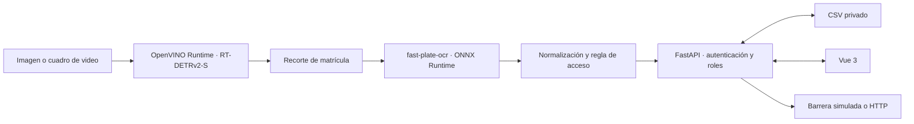

# Arquitectura SIRAP · RT-DETRv2-S + OpenVINO

## Flujo de la aplicación

El servicio valida la imagen, detecta la placa, obtiene un recorte y ejecuta OCR. El usuario revisa la lectura y la API calcula la autorización; la barrera solo se abre mediante la acción permitida y la operación se registra en el repositorio privado.

## Detector vigente

El detector es **RT-DETRv2-S (backbone ResNet-18vd)**. Parte del checkpoint de matrículas [`merve/license-plates-rtdetrv2`](https://huggingface.co/merve/license-plates-rtdetrv2), basado en [`PekingU/rtdetr_v2_r18vd`](https://huggingface.co/PekingU/rtdetr_v2_r18vd), ambos publicados bajo Apache-2.0. El checkpoint compartido es una inicialización general para placas; no está validado específicamente para Ecuador o EE. UU.

La aplicación en `src/model.py` carga `openvino_model.xml` y `openvino_model.bin` con `openvino.Core().compile_model(...)`. El detector no importa Transformers ni PyTorch durante inferencia. El preprocesamiento se guía por `sirap_openvino.json`; la clase `pixel_mask`, las cajas y las puntuaciones se decodifican en Python. El OCR `fast-plate-ocr` permanece separado y utiliza ONNX Runtime.

## Entrenamiento y exportación

El entrenamiento se realiza antes del despliegue con PyTorch y Transformers, desde los notebooks por país o `src/train.py`, usando datos COCO Detection. Después de guardar los pesos Safetensors, `src/export_openvino.py` convierte el checkpoint ajustado a OpenVINO IR. Se guardan ambos resultados bajo `models/<país>/detector/rtdetrv2_s/`: `transformers/` para entrenamiento y `openvino/` para la aplicación.

El Dockerfile convierte el checkpoint Apache-2.0 compartido durante la etapa de construcción y copia el IR al runtime final. La imagen de ejecución instala OpenVINO y OCR, pero no incluye PyTorch ni Transformers. El Space prefiere el IR ajustado del país si se publica o monta; en caso contrario usa el IR compartido. Los pesos generados de Ecuador y EE. UU. no se incluyen automáticamente en Git.

## OCR y decisión

`fast-plate-ocr` permanece independiente del detector. `ALPRPipeline` recorta las cajas, obtiene texto y confianza por carácter, normaliza la placa y devuelve métricas de tiempo. Las reglas del OCR y el almacenamiento están en `config/countries/`. Los umbrales detectores son provisionales hasta calibrarse para cada IR sobre validación; los umbrales YOLO no se transfieren.

## Capas de software

| Capa | Componentes | Responsabilidad |
|---|---|---|
| Presentación | Vue 3, Vite, Pinia | Reconocimiento, historial, dashboard, administración, idiomas |
| API | FastAPI, JWT, Pydantic | Autenticación, permisos, solicitudes e informes |
| Inferencia de detección | OpenVINO Runtime Python API, RT-DETRv2-S IR | Localización de matrículas en CPU |
| OCR | fast-plate-ocr, ONNX Runtime | Lectura de caracteres |
| Datos | CSV, repositorio privado GitHub | Persistencia de vehículos, autorizaciones y operaciones |
| Entrenamiento/exportación | `src/train.py`, `src/export_openvino.py`, notebooks | Ajuste fino y conversión previa al despliegue |
| Despliegue | Docker, Hugging Face Spaces | Construye el IR compartido y ejecuta la API en CPU |

El Space `SIRAP_USA_ECUADOR_HF` sincroniza desde este repositorio mediante GitHub Actions. La licencia del código del proyecto no sustituye la licencia del checkpoint ni las licencias de los datasets; consulte [THIRD_PARTY_NOTICES.md](../THIRD_PARTY_NOTICES.md).
