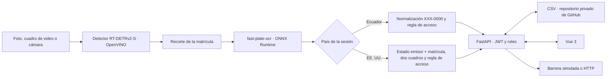

# Arquitectura de SIRAP · Ecuador y Estados Unidos

SIRAP es una aplicación FastAPI + Vue 3 para el control de acceso por matrícula. Una sola instancia atiende a **Ecuador** y a **Estados Unidos**: el país se elige al iniciar sesión, el token queda vinculado a ese país y el servidor rechaza solicitudes de otro. Este documento describe la aplicación desplegada; el uso paso a paso está en los [manuales PDF](manual/) y el detalle del perfil estadounidense en [usa_app_integration.md](usa_app_integration.md).

## Flujo de una lectura

1. El servicio valida la imagen (JPG, JPEG, PNG o WEBP; hasta 10 MB; lado menor de al menos 160 px), detecta la placa y recorta con un margen del 6 %.
2. El OCR devuelve el texto y la probabilidad de cada carácter. La confianza de la lectura es la **menor** de esas probabilidades.
3. La regla de acceso (`src/access_control.py`) calcula el resultado: *Autorizado*, *Sin autorización*, *Denegado*, *Revisión manual* o *No registrado*. Una lectura dudosa nunca se rechaza sola: pasa a revisión manual.
4. El operador revisa y confirma. La API vuelve a calcular la decisión con la placa final antes de registrar; la barrera **nunca se abre por sí sola** y solo se acciona con la acción permitida.
5. La operación se guarda con un identificador persistente, de modo que una recarga o un corte de conexión se puedan recuperar sin repetir la orden ([recuperacion_fallos.md](recuperacion_fallos.md)).

## Detector y OCR

| Componente | Valor vigente |
|---|---|
| Detector | **RT-DETRv2-S** (ResNet-18vd), ejecutado con OpenVINO Runtime nativo en CPU; no importa PyTorch ni Transformers en inferencia |
| Pesos | **Un único checkpoint compartido**, la **semilla 2** entrenada con placas de EE. UU. No existen pesos ecuatorianos aparte |
| Umbral de detección | 0,70 para ambos países |
| OCR | `cct-s-v2-global-model` de [fast-plate-ocr](https://github.com/ankandrew/fast-plate-ocr), mínimo de **0,94** por carácter |
| Origen del modelo base | [`merve/license-plates-rtdetrv2`](https://huggingface.co/merve/license-plates-rtdetrv2) sobre [`PekingU/rtdetr_v2_r18vd`](https://huggingface.co/PekingU/rtdetr_v2_r18vd), ambos Apache-2.0 |

El checkpoint se guarda en un **repositorio de modelos privado de Hugging Face** (`eduardoceballos/SIRAP_USA_seed2`) y se identifica por commit y huellas SHA-256 en [`models/usa/selected_checkpoint.json`](../models/usa/selected_checkpoint.json). Al iniciar, `src/usa_pipeline.py` descarga los archivos con el secreto de ejecución `SIRAP_USA_MODEL_TOKEN`, comprueba cada huella y se niega a usar un archivo que no coincida; no existe un detector alternativo de reserva. Para una instalación local se pueden indicar `SIRAP_USA_DETECTOR_DIR` y `SIRAP_USA_OCR_DIR`. La imagen de Docker no contiene los pesos ni los convierte durante la construcción.

**Alcance del rendimiento.** El checkpoint se ajustó y comprobó con placas de EE. UU.; cambiar las reglas del OCR no entrena un modelo para otro país. El desempeño en Ecuador **todavía no se ha evaluado**, y el de EE. UU. solo tiene una comprobación de desarrollo con fotos ya revisadas (no es un test independiente). Las cifras están en [`results/README.md`](../results/README.md) y se resumen en la pantalla *Acerca del modelo*.

## Reglas por país

| | Ecuador | Estados Unidos |
|---|---|---|
| Identidad | Matrícula normalizada `XXX-0000` (las de 3 dígitos se completan con 0) | Estado emisor + matrícula, por ejemplo `US:TX:BM5T299`; la misma matrícula de otro estado es otra identidad |
| Lectura del estado | No aplica | Tesseract lee la leyenda del estado en varias vistas; si no la reconoce, se abstiene |
| Confirmación para abrir | Revisión del operador | Dos cuadros distintos confirmados por el servidor en 7,5 s (comprobante de 30 s, de un solo uso) |
| Consulta de datos del vehículo | Servicios públicos del SRI (marca, modelo, año), con respaldo en el registro local | Informe público de J.D. Power (año/modelo, color, carrocería) con `vehicle_lookup.enabled: true`; con respaldo en el registro local |

La configuración de cada país está en `config/config.yaml` y `config/countries/{ecuador,usa}.yaml`.

## Capas

| Capa | Componentes | Responsabilidad |
|---|---|---|
| Presentación | Vue 3, Vite, Pinia, Vue Router, Tailwind 4, ECharts | Reconocimiento, registro, historial, dashboard, administración, ayuda y seis idiomas (inglés, español, portugués, francés, alemán, italiano) |
| API | FastAPI (`api/main.py`), routers `auth`, `recognition`, `reports`, `admin`; JWT HS256 de 12 h | Autenticación, permisos por rol (Operador, Supervisor, Administrador), reconocimiento, operaciones, informes y administración |
| Detección | OpenVINO Runtime, RT-DETRv2-S | Localización de matrículas en CPU |
| OCR | fast-plate-ocr, ONNX Runtime; Tesseract para el estado de EE. UU. | Lectura de la matrícula y del estado |
| Consultas externas | `src/detection_export.py` (SRI, Ecuador), `api/providers/usa_jdpower.py` (J.D. Power, EE. UU.) | Datos públicos del vehículo; no intervienen en la regla de autorización |
| Datos | CSV (`src/storage.py`) con el repositorio privado de GitHub como fuente duradera | Vehículos, autorizaciones, propietarios, garitas, usuarios y operaciones |
| Barrera | `SimulatedBarrier` o `HttpBarrier` (`barrera.modo` en la configuración) | Orden de apertura; por defecto simulada |
| Despliegue | Docker (Node 22 compila el frontend; Python 3.11 ejecuta la API), Hugging Face Spaces, GitHub Actions | Una imagen sirve la API y el frontend compilado en el puerto 7860 |

**Barrera real.** Con `barrera.modo: "http"` en `config/config.yaml` y las variables `BARRERA_URL` (HTTPS) y `BARRERA_TOKEN`, la API envía la orden con un `Idempotency-Key`, un plazo de 3 s, sin reintentos ni redirecciones. Sin ello, la barrera es simulada y el historial lo indica.

## Despliegue

El Space [`SIRAP_USA_ECUADOR_HF`](https://huggingface.co/spaces/eduardoceballos/SIRAP_USA_ECUADOR_HF) se sincroniza desde este repositorio con GitHub Actions (`deploy-hf-space.yml` → `deploy/huggingface/sync_space.py`); ver [CONFIGURACION_GITHUB_ACTIONS.md](CONFIGURACION_GITHUB_ACTIONS.md). El script comprueba que el repositorio de datos sea privado y que los CSV existan antes de publicar.

La aplicación heredada en Streamlit (`app.py` y `app/`) permanece en el repositorio, pero no se despliega.

## Licencias

La licencia del código del proyecto no sustituye la del checkpoint base ni las de los conjuntos de datos; consulte [THIRD_PARTY_NOTICES.md](../THIRD_PARTY_NOTICES.md) y [NOTICE](../NOTICE).
