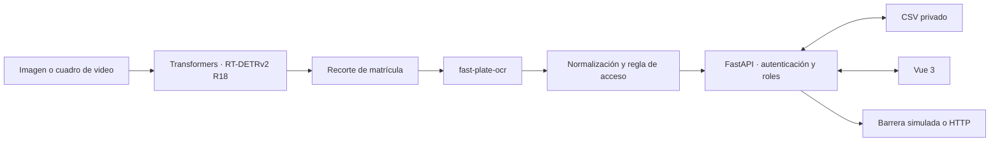

# Arquitectura SIRAP · RT-DETR + Transformers

## Flujo de la aplicación

El servicio valida la imagen, detecta la placa, obtiene un recorte y ejecuta OCR. El usuario revisa la lectura y la API calcula la autorización; la barrera solo se abre mediante la acción permitida y la operación se registra en el repositorio privado.

## Detector vigente

La implementación está en `src/model.py`. Usa `RTDetrV2ForObjectDetection` y `AutoImageProcessor` de Transformers. El checkpoint público predeterminado es [`merve/license-plates-rtdetrv2`](https://huggingface.co/merve/license-plates-rtdetrv2), entrenado para la clase `license_plate` y publicado bajo Apache-2.0. Su modelo base es [`PekingU/rtdetr_v2_r18vd`](https://huggingface.co/PekingU/rtdetr_v2_r18vd), RT-DETRv2 con backbone ResNet-18.

El entrenamiento mantiene rutas separadas: `models/ecuador/detector/rtdetr_r18/` y `models/usa/detector/rtdetr_r18/`. La API desplegada inicializa el perfil Ecuador desde `config/countries/ecuador.yaml`; la ruta USA sirve al entrenamiento independiente y no implica que su OCR/reglas ya estén integrados en esa instancia. El checkpoint compartido es una base general, no validada en Ecuador o EE. UU.

El entrenamiento reside en `src/train.py`: lee COCO Detection, actualiza el número de clases para `license_plate` y usa `Trainer`. Guarda pesos Safetensors y el manifest `sirap_training.json`. No depende de Ultralytics ni carga pesos `.pt`/ONNX YOLO. El convertidor opcional transforma etiquetas YOLO anteriores a COCO; solo es una herramienta de formato.

## OCR y decisión

`fast-plate-ocr` permanece independiente del detector. `ALPRPipeline` recorta las cajas, obtiene texto y confianza por carácter, normaliza la placa y devuelve métricas de tiempo. Las reglas del OCR y el almacenamiento están en `config/countries/`. Los umbrales detectores existentes son provisionales hasta calibrarse para cada checkpoint sobre validación; los umbrales YOLO no se transfieren.

## Capas de software

| Capa | Componentes | Responsabilidad |
|---|---|---|
| Presentación | Vue 3, Vite, Pinia | Reconocimiento, historial, dashboard, administración, idiomas |
| API | FastAPI, JWT, Pydantic | Autenticación, permisos, solicitudes e informes |
| Modelo | Transformers, PyTorch, RT-DETRv2; fast-plate-ocr | Detección y OCR |
| Datos | CSV, repositorio privado GitHub | Persistencia de vehículos, autorizaciones y operaciones |
| Entrenamiento | `src/train.py`, notebooks | Ajuste fino y evaluación reproducible por país |
| Despliegue | Docker, Hugging Face Spaces | API y web en CPU; modelo se obtiene del Hub al iniciar |

El Space `SIRAP_USA_ECUADOR_HF` sincroniza desde este repositorio mediante GitHub Actions. La licencia del código del proyecto no sustituye la licencia del checkpoint ni las licencias de los datasets.
